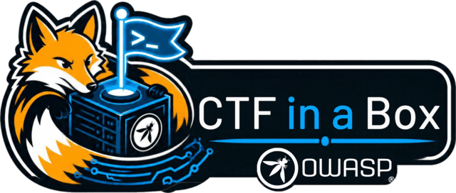
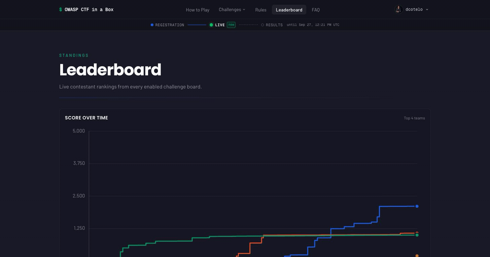
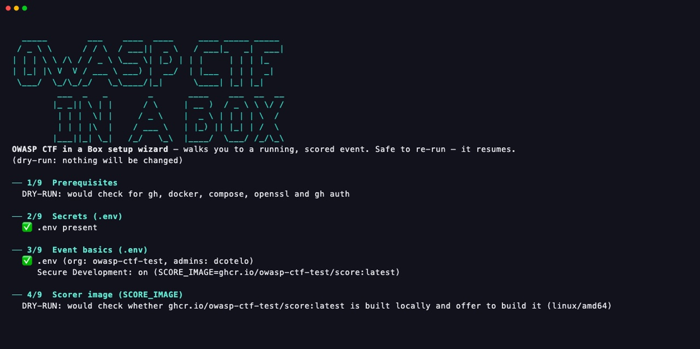
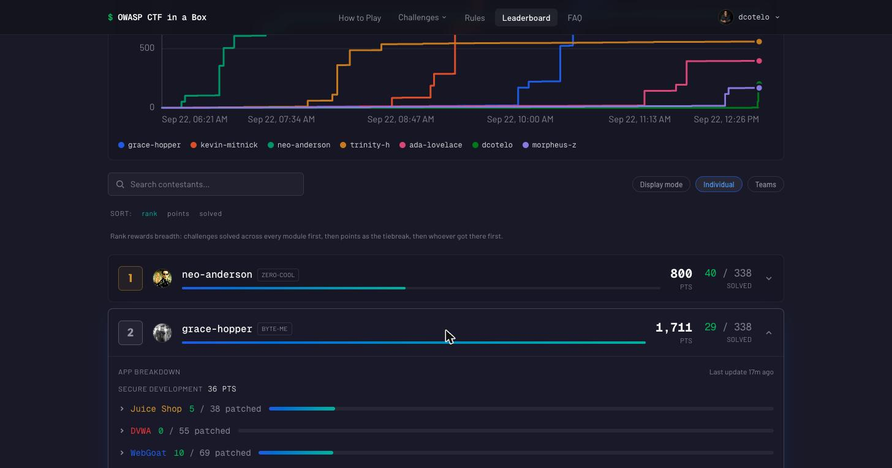
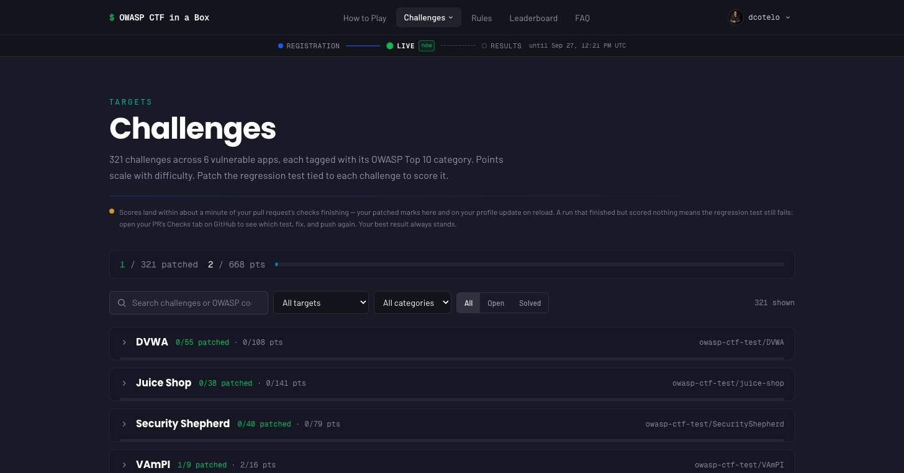
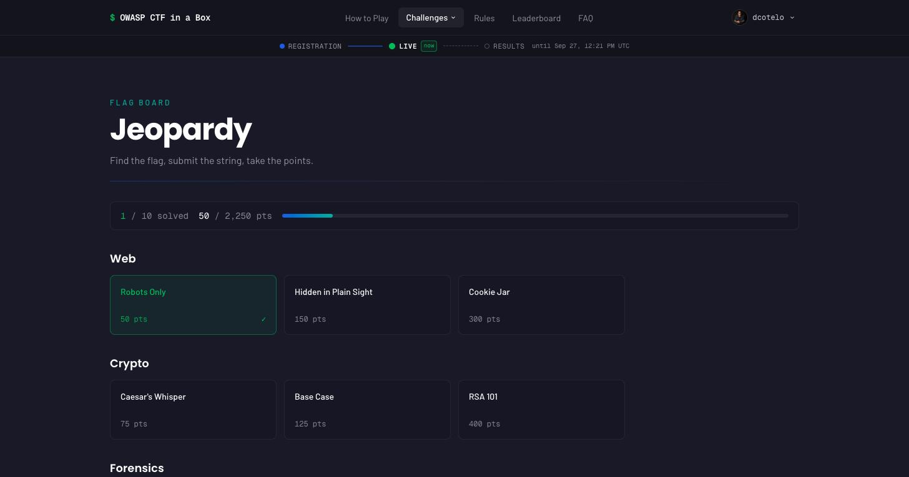
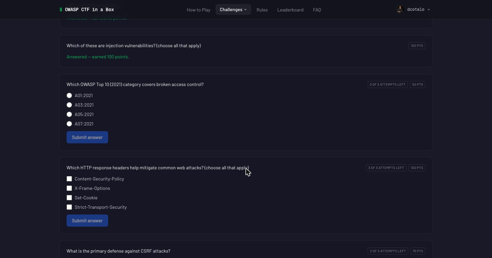

<p align="center">
  
</p>

<h1 align="center">OWASP CTF in a Box</h1>

<p align="center">
  <em>A self-hosted control plane for security-learning events — one box, one free GitHub org.<br>
  Run it for a university, a high school, an OWASP chapter, a meetup.</em>
</p>

<p align="center">
  <a href="https://github.com/OWASP/owasp-ctf-in-a-box/actions/workflows/ci.yml"></a>
  <a href="https://owasp.github.io/owasp-ctf-in-a-box/"></a>
  <a href="LICENSE"></a>
  <a href="docs/LICENSE"></a>
  <a href="https://owasp.org/projects/ctf-in-a-box"></a>
</p>

<p align="center">
  
</p>

## What this is

Everything a security event needs, on one machine you control: GitHub
sign-in, teams, a live leaderboard, an organizer admin panel, and the
scoring behind it. You pick which challenge **modules** run, alone or
together on one leaderboard:

- **Secure Development** — contestants fork a deliberately vulnerable app,
  **patch** the flaw, and open a pull request. The patch is tested
  automatically and scored. It teaches defence, not attack.
- **Quiz** — single- and multi-select security questions.
- **Jeopardy** — a board of flag challenges in categories, with optional
  paid hints.
- **AI** — prompt-injection and guardrail challenges hosted on an external
  site, scored back on the leaderboard.

It runs from Docker Compose on a laptop, a spare desktop or a small VPS, plus
one free GitHub org if you run Secure Development. The scoring rubrics for
all six vulnerable apps ship in the box, so there is no private image to
request and no scoring code to write. The kit is free and nothing phones
home; a cloud host or VPS costs whatever your provider charges.

**Who it's for:** course instructors, club organizers, OWASP chapter leads,
workshop facilitators, and security teams running an internal training day —
anyone who wants to run an event without becoming a cloud operator.

## Status

**v1.0, proven at a real event.** The first live event ran on October 7–9,
2026, on the [AWS module](docs/aws.md) behind Cloudflare:

| | |
|---|---|
| Teams | 28 |
| Players | 41 (24 attempted or scored) |
| Secure Development scores ingested | 498, none dropped |
| Requests served | about 465,000 on the two busiest days |

Known limits are listed in the open in
[Status and upstream dependencies](docs/operations.md#status-and-upstream-dependencies).

## Quickstart

**See it running in two minutes** — no GitHub org, no OAuth app, nothing to
configure. You need **Docker with Compose v2** and **`openssl`**:

```sh
git clone https://github.com/OWASP/owasp-ctf-in-a-box
cd owasp-ctf-in-a-box
./scripts/dev-stack up
```

It builds the stack, seeds a demo leaderboard and prints the URL to open.
`./scripts/dev-stack score <login> juice-shop 3` lands three more solves
live; `./scripts/dev-stack down` tears it down.

**Run a real event** with the guided wizard. You also need the
**[`gh` CLI](https://cli.github.com)**, signed in, and a free GitHub org if
the event runs Secure Development:

```sh
./setup/ctf-setup.sh check      # verify the tooling
./setup/ctf-setup.sh            # guided, prompts for values, resumable
```

It asks only for what your event needs, writes `.env`, does every step it
can automate, and walks you through the few that need the GitHub website.
`--dry-run` previews the steps that change anything, once `.env` has the
admin logins (and the org, if you run Secure Development). Everything
else — the event's name, which modules run, which targets — is set at
runtime in `/admin`, so there is no config file to edit.

<p align="center">
  
</p>

**In a cloud instead?** [docs/aws.md](docs/aws.md) (Terraform: ECS Fargate,
ElastiCache and an ALB) or [docs/fly.md](docs/fly.md) (one Fly machine).
Every step in detail:
[docs/hosting.md](docs/hosting.md#quickstart-zero-to-a-scored-event).

## The modules

**Secure Development** — a GitHub Action in the contestant's fork runs the
target's tests against the patch and posts the result on the pull request.
The box polls for it about every 30 seconds, and the leaderboard cache can
add up to about 40 more, so a score shows within about 70 seconds.
Six targets, 321 challenges. An unpatched app scores 0, and a correct patch
earns its points; CI checks both directions.

**Quiz** — graded the moment it is answered (all-or-nothing on
multi-select), with an attempt cap and a retry cooldown. Needs no GitHub.

**Jeopardy** — flags are trimmed and matched case-insensitively unless a
challenge is marked case-sensitive, with a submission cooldown and optional
paid hints. Challenges can be hidden or scheduled for later release. Needs no
GitHub.

**AI** — each contestant gets a personal launch link to the external
challenge site; a solve reports back through that site's callback or a flag
typed into the app. Needs no GitHub. The site's side of the contract is in
[docs/ai-module.md](docs/ai-module.md).

Quiz, Jeopardy and AI content is written in `/admin` or imported as one JSON
bundle. Around whichever modules you enable, the platform provides:

- **Teams** — self-registration with captains, join codes and `/join/<code>`
  links; **Play solo** makes a team of one.
- **A live leaderboard** with a score-over-time graph from real solve times.
- **The `/admin` panel** — freeze, scoring and registration windows, hints,
  team cap, cooldowns, module content, per-contestant support actions, an
  activity stream, engagement metrics and an audit log. All of it changes at
  runtime, with no rebuild.
- **Event archive** — export the event's content and settings, and import
  them into another box. Contestant progress is not exported.
  The archive holds every flag and quiz answer in plain text, so keep it as
  private as `/admin`.

| Contestant breakdown | Challenge browser |
|---|---|
|  |  |

| Jeopardy flag board | Quiz |
|---|---|
|  |  |

## Secure Development targets

| Target | Challenges | Points | Notes |
|---|---:|---:|---|
| `vulnerableapp` | 110 | 187 | Largest target |
| `webgoat` | 69 | 137 | Two-stage build: Maven, then the runtime image |
| `dvwa` | 55 | 108 | Needs a MariaDB sibling |
| `securityshepherd` | 40 | 79 | HTTPS, three-container stack |
| `juice-shop` | 38 | 141 | The only target with 6-star challenges |
| `vampi` | 9 | 16 | Small and quick — a good first target |
| **Total** | **321** | **668** | Setup forks all six; pick the live subset in `/admin` |

The rubrics live in `scorer/rubric.owasp/`, vendored from
[OWASP-CTF/dc34-owasp-secure-development-ctf](https://github.com/OWASP-CTF/dc34-owasp-secure-development-ctf).
They are public: the targets and their solutions are already published, so a
private rubric only protects against gaming the checks. To use your own, or
to write new ones, see [docs/scorer.md](docs/scorer.md).

## How it works

One Docker Compose stack. Caddy terminates TLS in front of the Next.js app,
and the app reaches Redis only through a REST proxy on a split network, so
nothing internet-facing can reach Redis directly. Quiz, Jeopardy and AI are
graded inside the app.

Secure Development is graded *outside* the box: the contestant's fork runs a
GitHub Action that boots the target, tests the patch, and posts a score
comment on the pull request. The box's `sync` service polls GitHub for those
comments, so nothing has to reach your box from outside — it works behind NAT,
on a campus network or on venue wifi. Scores only ever go up: a later failing
run never takes back a solve.


Components, the score data flow and the security model:
[docs/architecture.md](docs/architecture.md). Why it is built this way:
[docs/decisions.md](docs/decisions.md).

## Running an event

- **Contestants** sign in with GitHub and form or join a team (a team is
  required to score), then play whichever modules you enabled.
- **Organizers** run everything from `/admin`: the schedule, the freeze,
  registration, content — and when one contestant gets stuck, they fix that
  one contestant instead of resetting the event.
- **Before the doors open**, walk [the security checklist](docs/security-checklist.md).
- **When it's over**, `./setup/ctf-setup.sh teardown` archives the target
  repos; then uninstall the GitHub App and delete the org's Actions secrets
  yourself.

On a Compose box, all state lives in named Docker volumes, so a reboot loses
nothing; the AWS module keeps it in ElastiCache instead. The full
organizer guide is [docs/operations.md](docs/operations.md).

## What it is not

- **Not a general CTF platform.** For a conventional jeopardy or
  attack-defense event with maximum flexibility, use
  [CTFd](https://ctfd.io/). This kit's Jeopardy module is deliberately
  smaller.
- **Not a hosted practice gym.** If you don't need to run your *own* event,
  [picoCTF](https://picoctf.org/) needs zero operations.
- **Not an attack trainer.** The flagship module grades *patches*, not
  exploits.

## Documentation

| Read this when you're… | Document |
|---|---|
| Standing the kit up | [docs/hosting.md](docs/hosting.md) — prerequisites, the wizard and every step, the GitHub OAuth app, the `.env` bootstrap |
| Deploying to a cloud | [docs/aws.md](docs/aws.md) (Terraform: ECS Fargate + ElastiCache + ALB) · [docs/fly.md](docs/fly.md) (one Fly machine) |
| About to open the doors | [docs/security-checklist.md](docs/security-checklist.md) — the one-page pre-event walk |
| Running the event | [docs/operations.md](docs/operations.md) — teams, the admin panel, the module guides, teardown |
| Fixing something | [docs/troubleshooting.md](docs/troubleshooting.md) — symptom by symptom |
| Understanding the system | [docs/architecture.md](docs/architecture.md) — diagram, score data flow, security model, testing |
| Writing a rubric | [docs/scorer.md](docs/scorer.md) — both rubric formats, authoring and building |
| Building a new module | [docs/modules.md](docs/modules.md) — the platform/module contract |
| Asking "why is it like this?" | [docs/decisions.md](docs/decisions.md) — numbered ADRs |

Rendered at **[owasp.github.io/owasp-ctf-in-a-box](https://owasp.github.io/owasp-ctf-in-a-box/)**.

## Contributing and security

Contributions are welcome. [CONTRIBUTING.md](CONTRIBUTING.md) covers the dev
environment, the CI gates and how to propose a module (start with an issue,
not a PR); [CODE_OF_CONDUCT.md](CODE_OF_CONDUCT.md) applies. Small,
well-specified work is tagged
[`good first issue`](https://github.com/OWASP/owasp-ctf-in-a-box/issues?q=is%3Aissue+is%3Aopen+label%3A%22good+first+issue%22).
Sign off every commit with `git commit -s`
([Developer Certificate of Origin](https://developercertificate.org/)).

Humans and AI agents alike should read [AGENTS.md](AGENTS.md) before writing
code: it lists the exact commands CI runs and the mistakes this repo has
already made. A change is ready when CI is green and every CodeRabbit review
thread on the latest commit is resolved.

Found a vulnerability in the kit itself? See **[SECURITY.md](SECURITY.md)**.
The targets' vulnerabilities are intentional and out of scope.

## License and credits

Code is **MIT** ([LICENSE](LICENSE)); the documentation — this README and
the Markdown under `docs/` — is **CC BY-SA 4.0** ([docs/LICENSE](docs/LICENSE)),
as the [OWASP Project Policy](https://policy.owasp.org/operational/projects)
requires.

This is an **OWASP Foundation** incubator project —
[owasp.org/projects/ctf-in-a-box](https://owasp.org/projects/ctf-in-a-box).
The rubrics come from the
[OWASP-CTF](https://github.com/OWASP-CTF/dc34-owasp-secure-development-ctf)
event; this kit exists because that event was worth running more than once.
The vulnerable targets are not vendored: events fork them from their own
upstreams, and each keeps its own license —
[Juice Shop](https://github.com/juice-shop/juice-shop),
[WebGoat](https://github.com/WebGoat/WebGoat),
[Security Shepherd](https://github.com/OWASP/SecurityShepherd) and
[VulnerableApp](https://github.com/SasanLabs/VulnerableApp) are OWASP
projects; [DVWA](https://github.com/digininja/DVWA) and
[VAmPI](https://github.com/erev0s/VAmPI) are community projects.

OWASP® is a registered trademark of the OWASP Foundation. OWASP does not
endorse or recommend any product or service, including the targets and
services this kit integrates with.
