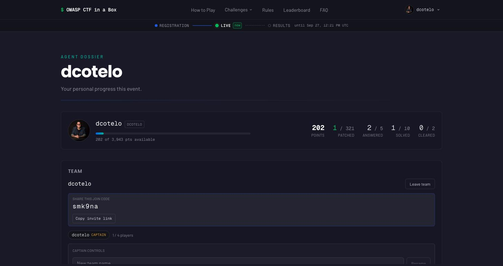
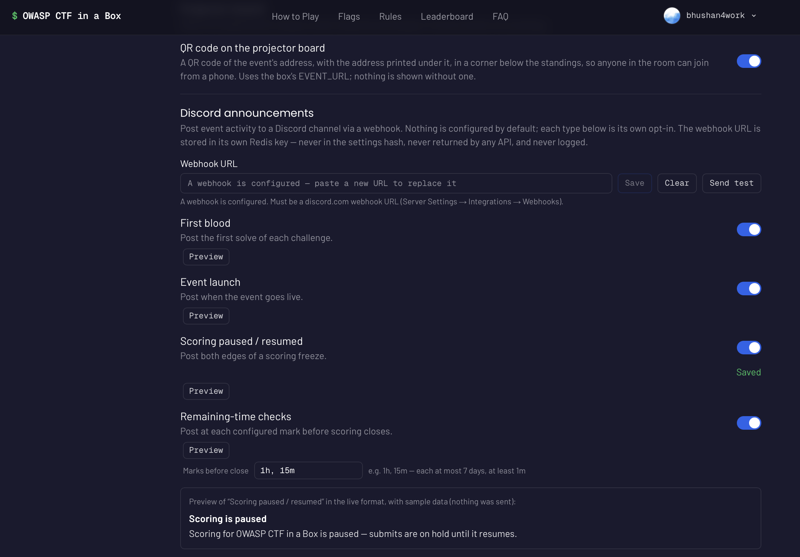
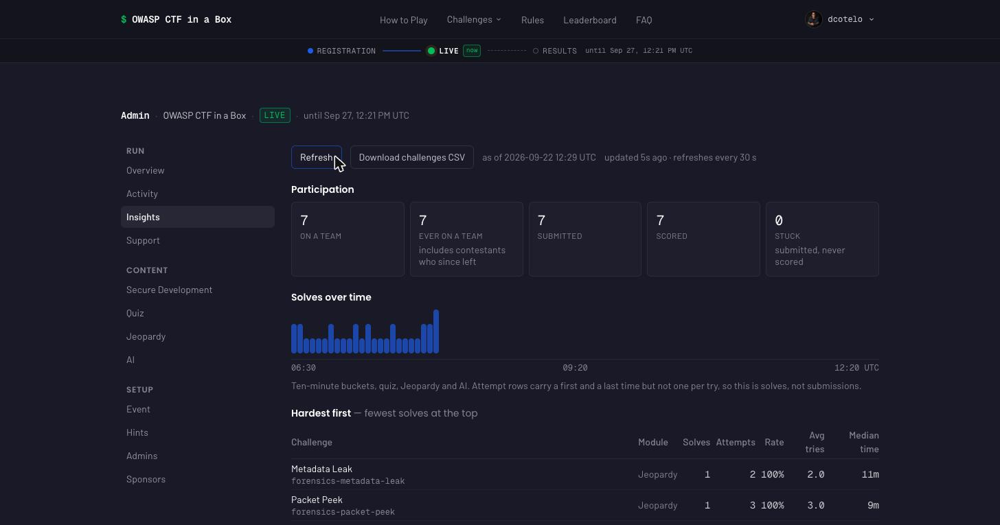
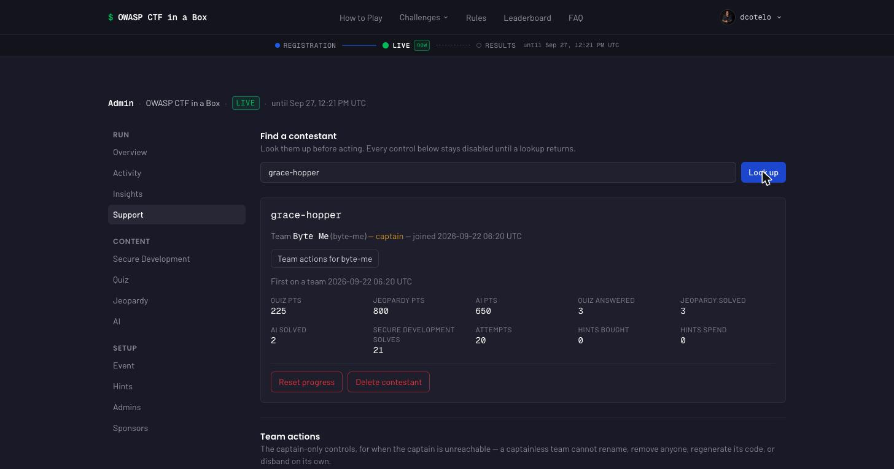
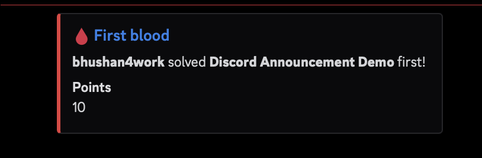
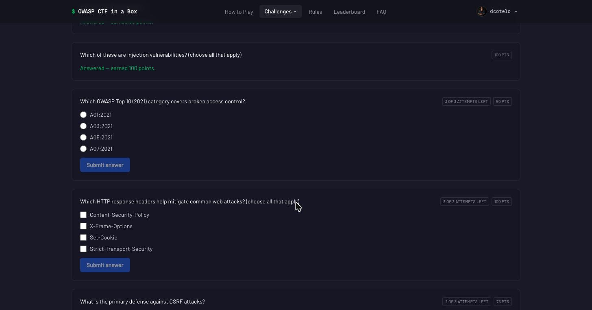
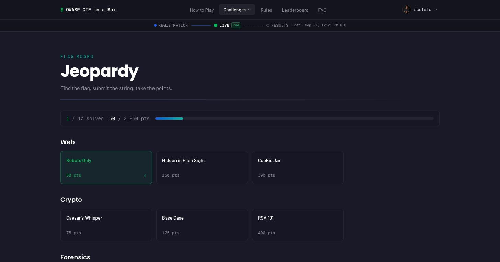

[← Docs home](index.md)

# Operations

Running the event once it is up: what organizers do during and after, the
admin panel, how teams work, how to verify the kit before an event, the local
dev-stack for clicking through the real experience, and the current status of
live-GitHub scoring. For standing the kit up in the first place, see
[docs/hosting.md](hosting.md).

**On this page:**
[Running an event](#running-an-event) ·
[Teams](#teams) ·
[Admin panel](#organizer-admin-panel) ·
[Archiving and replaying an event](#archiving-and-replaying-an-event) ·
[Quiz](#quiz) ·
[Jeopardy](#jeopardy) ·
[Verifying it works](#verifying-it-works) ·
[Local dev-stack](#local-dev-stack) ·
[Before launch](#before-launch) ·
[Status](#status-and-upstream-dependencies)

## Running an event

**During:**

- The leaderboard and app live at the `EVENT_URL` you configured in `.env`.
- **How fresh the board is.** The folded standings — every module's points,
  team totals, the chart, hint penalties — are computed once and shared by
  every viewer for **10 seconds**, then recomputed on the next request
  (`apps/web/src/lib/leaderboard/folded.ts`). A quiz answer or a flag
  therefore reaches `/leaderboard` and the landing strip within about
  10 seconds; the projector board refreshes itself every 30. A Secure
  Development score has one more hop: the `sync` poller reads the score
  comment on its next poll (about every 30 seconds), and the app reads the
  scorer uncached, so a score normally shows within about 40 seconds of the
  comment (the v1.0.1 release check measured 27). A contestant's own
  `/profile`, `/quiz`, `/flags` and `/challenges` read live. A read that
  fails is never cached — the next request retries.
- Poller logs: `docker compose logs -f sync`. On Fly: `fly logs --app <app>`.
- All state lives in named Docker volumes, so a box reboot loses nothing.
- **On AWS (ECS)**, the logs, a shell, the failure drills, rollback and
  tear-down are in the [AWS event-day runbook](aws.md#running-the-event-on-aws).
  Everything else on this page applies unchanged.

**After** — preview the teardown, then run it:

```sh
./setup/ctf-setup.sh teardown --dry-run
./setup/ctf-setup.sh teardown
```

This archives each target repo in the event org. It does **not** revoke
credentials or delete secrets — do that yourself: uninstall the GitHub App,
and delete any Actions secrets the org still carries. `LEADERBOARD_URL` /
`LEADERBOARD_TOKEN` are the ones to look for on an org that has hosted an
event before: push ingest was removed in v0.6
([#377](https://github.com/OWASP/owasp-ctf-in-a-box/issues/377)), so nothing reads
them and they are just credentials every contestant-triggered run can read.
Check the org's **Settings → Secrets and variables → Actions** page — `ctf-setup.sh doctor` no longer does (#503).

## Account sign-up and sign-in limits

Players create accounts and sign in at `/sign-in` ([Hosting](hosting.md#player-accounts)).
The app throttles those endpoints itself, in Redis, and **fails closed**: if
Redis cannot be reached the request is refused rather than allowed. A refusal
is HTTP 429 with a `Retry-After` header, and the form says "Too many
attempts. Try again in N seconds."

| Budget | Limit | Window |
|---|---|---|
| Account creation, per client address | 300 | 10 minutes |
| Sign-in (password, and starting a GitHub sign-in or link), per client address | 600 | 10 minutes |
| Password attempts, per client address and username | 10 | 15 minutes |

The address is the one the box's own proxy vouches for, never a value the
client chooses (`apps/web/src/lib/client-ip.ts`):

| Deploy path | Address |
|---|---|
| Compose (Caddy) | the rightmost `X-Forwarded-For` entry, which Caddy appends |
| AWS (ALB) | the rightmost `X-Forwarded-For` entry, which the ALB appends |
| Fly | `Fly-Client-IP`, set by Fly's proxy; the rendered compose file sets `TRUSTED_CLIENT_IP_HEADER=fly-client-ip` on the app |

`TRUSTED_CLIENT_IP_HEADER` is not set by hand. On compose or AWS it would
let a client choose its own address, and an invalid header name stops the
app at startup. Behind Cloudflare every path sees Cloudflare's edge, so every
player routed through the same edge shares the two per-address budgets. They
are sized for a room of a few hundred people to sign up together. The
per-username budget keys on address and username together, so one player
mistyping a password does not lock anyone else out. The limits live in
`RATE_LIMITS` in `apps/web/src/lib/rate-limit-store.ts`; there is no setting
for them in `/admin`.

Password sign-ins and sign-ups appear in the admin activity log. A player who
loses a password asks an organizer for a reset code ([Accounts](#accounts)).
Redeeming one at `/reset` has its own budget of 300 per 15 minutes per client
address.

## Teams

Scoring is per team, and **a team is required** — nothing a contestant solves
counts until they are on one. Contestants self-register in the app: create a
team to become its captain and get a join code, join an existing team by code,
or hit **Play solo** for a one-click team of one named after their
username. Everyone ends up on a team — a solo player is simply a team of one.

The requirement is enforced in three places, earliest first. **At sign-in**:
every sign-in lands on a post-signin step that sends a contestant with
no team straight to the team card — team setup is the first thing a new
contestant completes, not something discovered later (a `/join/<code>` invite
passes through untouched, since the invite *is* the team step). **At the
module pages**: a signed-in contestant with no team who opens `/quiz`,
or `/flags` is sent to the team card too, so nobody who slipped past the first
step discovers the rule by answering a question and watching it not count.
**At the routes**: the quiz and flag submission routes refuse a teamless
login outright — the boundary that actually holds. Organizers are exempt
from both redirects — they sign in to check that their content renders,
which is not playing — but not from the submission check, since an
organizer's points would fold into no team either. **So a teamless
organizer gets a notice above the form instead**, naming the same fix and
the one-click **Play solo**: the exemption is from the redirect, not from
being told. Without it the rule reached them the expensive way — the form
rendered, the route refused the submission, and they learned the
requirement from a solve that did not count, which made the people most
likely to be testing a board the ones guaranteed to discover it by losing
something to it. If registration is closed when a teamless contestant
reaches the team card, it explains that instead of offering forms the
routes would refuse.

> **Secure Development still has no route to refuse.** Its points arrive
> from GitHub through the sync poller rather than through an app route, so a
> contestant who patches a fork while on no team has their score ingested
> against a player that belongs to no team, and it contributes to no team
> total **until they join one** — team totals fold from current membership
> at read time, so already-banked solves count from the moment the player is
> on a team. That deferred-credit behavior is deliberate: refusing the score
> at ingestion would lose it permanently (the poller marks the comment seen),
> whereas banking the score against the player only delays credit. The
> sign-in steering
> above is what closes the gap in practice — it is the only enforcement
> point this module's scoring path passes through — so it matters most for
> events running Secure Development.
>
> Deferred credit needs the PR author to be a linked player when sync reads
> the score: a contestant links their GitHub login from `/profile`, or by
> signing in with GitHub when that provider is on.
> A score whose author nobody has linked is held, not dropped: sync releases
> it on a later tick once the author links before Scoring closes. A link made
> at or after the close never releases it; the Secure Development admin tab
> lists it as `unclaimed`.

Captains
manage the roster from the app: rename the team, remove a member, transfer the
captaincy, regenerate the join code, or disband. A team name is up to 32
characters, counted after Unicode normalization (NFC). Any script and emoji
may appear in it, but a new team's name needs at least one letter a–z or
digit 0–9, because the team's id (its key and invite URL) is built from
those; a rename keeps the id, so it has no such need. A name with nothing
visible (zero-width or control characters, or the blank Braille cell U+2800,
alone) or
with a text-direction control character (U+202E and the rest of the bidi
controls) is refused on create and on rename, and every page shows a team
name direction-isolated, so a name stored before that check cannot reorder
the row around it (#603). The join code doubles as a
shareable link — **Copy invite link** on the team card yields
`https://<your-event>/join/<code>`, which a teammate opens and joins in one
click. Signing in mid-way keeps the invite: the code lives in the URL, so the
GitHub round-trip returns to the same page. Regenerating the code invalidates
any link that carried the old one. Team size is capped at four members by
default; an organizer changes that from the admin panel's **Event** tab
("Players per team") without a rebuild.

The leaderboard ranks **teams**, and each row expands to show its members with
each member's individual points. A flag solved by several teammates counts
**once** for the team, so a team's total can be lower than its members' scores
added together — the leaderboard dedupes shared solves rather than
double-counting them. Organizers open or close the registration window from
the admin panel below — by hand with the **Team registration** switch, or on
a timer with the **Registration opens** / **Registration closes** schedule
fields. While it is closed nobody can create or join a team, and a captain
cannot rename it or regenerate its code; **transfer captaincy, disband,
leave and remove member still work**, because those are exits and gating
them would trap a player or a captain behind a closed window. Leave and
remove member ask for confirmation first, though: a player who leaves (or is
removed) after close **cannot join any team again on their own**, and their
points leave the team's total. The warning says so, the request is refused
until it is confirmed, and an organizer can put the player back from
**Support → Add to team** (see below).



<sup>The profile is where teams live day to day: the join code and invite link
to share, the captain's controls, and a header stat per enabled module.</sup>

## Organizer admin panel

An admin is a kit account that claimed an **admin claim code** ([ADR 72](decisions.md#adr-72-admins-are-claimed-with-a-one-time-code-not-named-in-env)).
Everyone else gets a 403 on `/admin` and its API routes; the Forbidden page
links to `/admin/claim`.

The first code's SHA-256 is `ADMIN_CLAIM_CODE_HASH` (in `.env`, or SSM on AWS); the
code itself is never stored. Provisioning prints the code once:
`ctf-setup.sh secrets` on a Compose box, `deploy/fly/deploy.sh init` on
Fly, and the first `deploy/aws-terraform/deploy.sh` after the stack is
applied on AWS. Lost it? See
**Locked out?** below. Sign in, open
`/admin/claim` and enter the code: the account you are signed in with becomes an admin. Each code
works once. Further organizers get a code from the **Admins** tab (see
below). Until somebody claims, `/admin` refuses everyone and its Forbidden
page says so.

The header is one row — `Admin · <event name> · <phase badge> · until <date>`
— with the same phase vocabulary and colours as the public phase strip. The
controls sit behind a **left sidebar** in three groups (it collapses to a
"Sections" drawer on narrow screens):

- **Run** — **Overview**, **Activity**, **Insights**, **Support**.
- **Content** — **one destination per enabled module**, in event-config
  order, labelled with that module's name as the organizer has set it. A
  module's own knobs live in its own destination, so an event that doesn't
  run a module never sees its settings at all.
- **Setup** — **Event** (identity, modules, freeze, team registration, team
  size, the schedule, then demo seed and the master reset at the bottom),
  **Hints**, **Admins**, **Sponsors**.



**Overview is the default** on load, regardless of how many modules are
enabled — unless the URL names another destination (see the deep links
below). It answers "is scoring on, how many teams, is anything stuck" in one
screen: the phase and time remaining, **Scoring** and **Registration** as
switches you can flip from there, the team / player / submitted / stuck
figures (stuck leads when it is non-zero), the poller's sync health line
(one line — last poll, ingested, dropped, running/paused — that opens into
the full breakdown, repos polled, last drop and last error), the five most
recent activity rows, and a setup-status line per module ("checking…"
until that module's own panel has reported its counts;
"enabled" for a module with nothing countable). The figures and the activity
rows load when you open Overview and, **while the event phase is live,
refresh every 15 seconds**; the stamp on the phase row ("updated 12s ago ·
refreshes every 15 s") says how old the read is, and reads "auto-refresh
paused while the event is not live" before scoring opens or once it is
frozen or over — the panel still loads once when you open it, but the
numbers do not move in those phases, so nothing is re-polled. While live, a
hidden browser tab never polls, and switching back to it refreshes at once.
A read that fails says so in place rather than sitting on "Loading…", keeps
the previous figures and the stamp's age (so retained data is never called
"updated"), and clears itself when a later refresh succeeds.

Every on/off control in the panel — the module switches, Freeze scoring and
Team registration on Event, Scoring and Registration on Overview, Hints
enabled — is a switch that reports its own save beside the row: "Saving…",
then "Saved" for a moment, or the reason the server refused it (with the
switch snapped back to the stored state). Overview's Scoring switch and
Event's Freeze scoring row write the same setting, so a flip on either
screen shows "Saved" on both. The numeric fields do the same and no longer
show a browser spinner: type the value, tab out, read the line under it.

The hint policy has its own **Hints** destination because it is event-wide:
Secure Development and Jeopardy both sell their hints through the same
four settings (`hintsEnabled`, `hintCost`, `hintsMinSolves`,
`hintsUnlockAfterMin`).

**Every module screen opens with a sticky header and a setup status line.**
The header is the module's name and its **Enabled** switch — the same control
as the module's row on Event, with the same lock (the last live module cannot
be switched off) and the same confirmation, so a flip on either screen shows
"Saved" on both. Under it, one line — "Setup complete · 4 categories · 12
challenges" — opens into the setup checklist: what contestants experience in
that module, the steps you do **in this panel** in dependency order, and a
link to that module's section of this page. The checklist is **expanded only
while a step the panel can verify is still to do**; once questions or
challenges or categories exist it collapses to the line, and stays collapsed
while the counts are still loading ("checking…") rather than accuse a set-up
module on first paint. Steps done outside the panel (`ctf-setup.sh`, the
GitHub org, `.env`) are not repeated — the screen exists only while the
module is enabled, so they are behind you; the linked guide has them. A
second line, **What is safe to change mid-event**, opens the safe / not-safe
lists. All of it is registry content (the module contract's §5.9), not copy
typed into each tab.

**Settings card.** Below the status line, one card holds the module's
**title** and **blurb** side by side, its own knobs (the quiz's retry gate,
the cooldowns), and — on every module that sells hints — a link to the Hints
screen where their price lives. The title is capped at 60 characters, the
blurb at 200; both are plain text only — control characters and Unicode
bidi-override characters are rejected, since there is no markup to sanitise,
only rendered text to keep intact. **Leaving a field blank clears the override
and restores the module's registry default** — the field's placeholder shows
what that default is, so clearing it is discoverable rather than a guess.
Changes are
live on the next request; there is no rebuild and no cache to wait out.

**Where a rename actually shows up.** Set a title and it replaces the module's
name in three places on every event: **the tab's own label**, **the nav link**
(header and footer alike), and **the module's own page header and browser tab
title** (`/challenges` for Secure Development, `/quiz` for Quiz, `/flags` for
Jeopardy). It also reaches two more surfaces on every event:

- the **landing page's module card** — each card under "The game" (or "The
  games", with more than one module) is headed by the module's title, override
  included. The page's uppercase kicker above it comes from the modules'
  registry taglines, which are **not** overridable at all;
- the **team leaderboard's per-module rows** — an expanded team row labels
  each module's progress with its title, even when only one module runs.

One surface is **suppressed on a single-module event**, which is what most
events are: the **individual leaderboard row's per-module block heading**,
hidden while only one module is enabled because a row's points *are* that
module's and the heading would only restate the column above it. Nothing is
broken if a contestant's own row does not show your new name on a one-module
event — that heading only appears once there are two modules to tell apart.

**The blurb is contestant-facing copy — write it as such.** It reaches three
places:

- the **meta description** of the module's own page (what a search result or a
  chat link preview shows);
- **`/quiz`'s and `/flags`'s page header**, as the lede under
  the title. This is the module describing itself; a contestant's own progress lives on the
  board itself (Quiz's progress strip, Jeopardy's "Your run" rail), and a
  signed-out visitor sees a "Sign in to …" line above the
  questions/challenges;
- the **landing page section lede**, but only for a module that ships no
  registry `home` block. All three modules that exist today have one, so
  today this
  is a fallback for a future module rather than something you can see —
  Secure Development's, Quiz's and Jeopardy's landing copy all come
  from the
  registry and are
  not organizer-editable.

Leaving it blank restores the module's registry default, which is a complete
sentence, so a blank blurb is a perfectly good answer — it is never an empty
line on a page.

The panel offers:

- **Identity** (Event tab, top of the page) — how the event names itself, a
  runtime `/admin` setting (issue #386). It is the only place these
  fields exist: there is no config file to set them in and nothing is baked
  into the image. Each restores its default when left blank: **Event name** (≤80
  characters; blank restores "OWASP CTF in a Box"; shown in page titles,
  the header, the leaderboard, and this panel's own master-reset confirmation),
  **Location** (≤160; shown beside the dates on the landing
  page and in the page description; blank hides it), **Timezone** (≤64; an
  IANA zone such as `America/Argentina/Buenos_Aires`, suggested as you type;
  the landing page's dates, the phase line, the score chart's axis and the
  schedule inputs below and the admin activity times (Overview and the
  Activity tab, to the second; a "Show UTC" switch beside each flips them
  to UTC and is remembered per browser) read on this clock (Insights' "as of"
  time and Support's joined and first-on-a-team times stay UTC, to the second,
  to match against logs; the Insights timeline counts ten-minute buckets, so
  its labels stay at the minute); the phase line and the launch status name its offset, e.g. "9:00 AM
  GMT-3"; blank means UTC, the output before this setting existed), **Contact e-mail**
  (≤254; the organizers' own inbox, rendered as a `mailto:` link on the
  privacy and terms pages; blank hides it), and **Discord invite** (≤200;
  must be an `https://` URL; the header, hero, rules, how-to-play, FAQ and
  404 pages link to it; blank hides every Discord mention), and **Logo link**
  (≤2048; an `https://` URL with no `user:pass@`; the landing page's event
  logo opens it in a new tab; blank leaves the logo unlinked, and it does
  nothing until a logo is uploaded). Changes are live
  on the **next page load** — no rebuild, no cache to wait out.

  Below the fields, two **images** (issue #529) — each picked from a file,
  saved at once, and undone with **Restore default**:
  - **Logo** — PNG, JPEG or WebP, up to 128 KB and 4096 px a side. It leads
    the landing page's hero (shown up to 224 px tall and 32 rem wide on a
    desktop, 144 px tall on a phone, whatever its shape; clickable when a
    **Logo link** is set), and a smaller project logo, which carries the
    OWASP mark, stays beside it, captioned "Built with OWASP CTF in a Box": the
    OWASP Project Policy wants OWASP branding prominent on any domain the kit
    runs on, so an event adds its logo and never removes OWASP's (ADR 65).
    It is shown as uploaded on the dark navy hero — upload a version made for
    a dark background. With no logo set, the hero shows the project logo
    alone.
  - **Favicon** — the browser tab icon: a square PNG, 32–512 px, up to 32 KB.
    With none set, the project's built-in icon is used.

  The server checks each file's real bytes, not its name or claimed type, and
  refuses SVG outright (an SVG served from the box can run script). Both are
  served from the box's own origin at `/api/event/logo` and
  `/api/event/icon`; pages link them with `?v=<etag>`, so a replacement
  shows on the next page load even where a browser holds on to favicons. A
  **master reset keeps them** — like the name, they are the event's identity,
  not progress. An event archive carries the logo and its **Logo link**
  together; contact and Discord never travel in one.
- **Sync** (Overview tab, shown only while Secure Development is present) —
  the sync poller's heartbeat as one line (last poll time, comments ingested,
  comments **dropped**, running or paused) that expands to the full
  breakdown: repos polled, whether sync is paused, the last drop and the
  last error. A score held for an unlinked PR author is not a drop and does
  not count here (earlier builds counted it as `unlinked`). With no Scoring
  end set, a held score releases as soon as its author has linked. With an
  end set, it releases only if the link was made before the close; a link
  with no recorded time counts as made after it, and only a sign-in by that
  player before the close stamps a time that releases.

  **Read Ingested and Dropped together.** Ingested is points that reached the
  leaderboard; Dropped is points that reached a contestant's PR and stopped
  there — the scorer rejected the submission, or the comment carried a
  `ctf-score:` marker the poller could not read. Dropped should be **0** on a
  healthy event; it turns amber and a **Last drop** line names the repo, the
  PR, and the reason when it isn't. Neither figure resets on its own: a
  dropped score is still missing after the poller recovers, so the pointer to
  the PR that needs looking at stays up (unlike Last error, which describes
  only the most recent tick). A nonzero Dropped means a contestant is looking
  at a correct score on their PR that the leaderboard does not show — go read
  the poller's logs for the matching line, fix the cause, and re-run that PR's
  scoring workflow.

  Routine things are deliberately **not** counted here: a comment re-read at
  the cursor boundary, and the workflow's own "⏳ Scoring in progress…"
  placeholder, are both expected and leave Dropped at 0. Neither is a score
  the scorer **refused because of when it was posted** — before the launch,
  while scoring was frozen, after the end, or before a master reset (see
  Freeze below): that is the rule working, not a loss, so it is logged as
  `submit <repo>#<pr>: refused (<reason>), not scored` and left out of
  Dropped. The poller's logs carry a per-repo breakdown of all of these on
  any tick where something non-routine happened.
- **Freeze** — a pause switch. Pausing **freezes scoring, not fork
  Actions**: contestants' PRs keep getting judged and commented on exactly
  as before. Quiz and Jeopardy answers are refused while it is on.
  A **Secure Development** score is judged by **when its score comment was
  posted on the PR**, not when the box reads it (ADR 67): a PR scored
  *before* you froze still counts, even if the poller reads it during the
  freeze, and a PR scored *while* frozen never counts, not even after you
  un-freeze. The same rule applies to the scoring window: a PR scored before
  **Scoring closes** counts even if it is read later, and one scored before
  the launch or after the end does not. The poller keeps reading during a
  freeze and the scorer decides each score; the refusals are final and show
  in the poller's log as `refused (paused)`, `refused (outside-window)` or
  `refused (pre-reset)`, not in Dropped.

  To make that possible the box records *when* each freeze ran, not only
  whether one is on: freezing stores the start (`pausedSince` in the settings
  hash) and un-freezing moves the interval onto `ctf:admin:pauses` (the last
  200 are kept). Both are written by the same save as the switch. A freeze
  set straight on the hash with no recorded start (by hand, or left over from
  a version without the log) has an unknown start, so the scorer **holds**
  Secure Development scores read during it (`503`, retried) rather than
  refusing them, and judges them once it lifts — that one freeze then lets in
  a PR scored during it.

  **One edge, by design.** A PR's score comment is *edited* on every run, so
  its time is the time of the **last** run. A solve the box already recorded
  keeps its first time. But if the poller was down across a re-run, a solve
  first read from the re-run gets the re-run's time, and a re-run after the
  event ends refuses a solve that was never read, even if its first passing
  run was in time. Normally the poller reads each comment within a minute, so
  this needs the poller to have been down across the re-run.
- **Projector board** (Event tab) — **QR code on the projector board**, on
  by default: display mode (`/leaderboard?display=1`) shows a QR code of the
  event's address, with the address printed under it, in the bottom-right
  corner below the standings, so anyone in the room can join from a phone
  (#592). The code is the box's own origin from `EVENT_URL` (compose passes it
  as `BETTER_AUTH_URL`); with none set, no code is shown rather than one
  guessed from the request. It is encoded on the server into an inline SVG,
  with no third-party service and no request from the viewer's browser. The
  regular `/leaderboard` never shows it.
- **Sign-in** (Event tab) — the GitHub sign-in switch, on by default;
  without both GitHub keys in `.env` there is no switch. Turning it off stops
  new GitHub sign-ins: the button leaves `/sign-in`, and a GitHub sign-in
  already started is refused at the callback too. It does not sign out
  existing sessions. Username and password is always on. Switching GitHub
  off also stops players whose only way in is GitHub; they can add a
  password from their profile first, or an organizer can help. With Secure Development on, players can still link
  GitHub from their profile while GitHub sign-in is off.
- **Modules** (Event tab) — which modules this event serves, switchable
  **during the event without a rebuild**. Switching one off removes its nav
  link and stops its board resolving on everyone's next page load; switching it
  on brings both back.

  **It deletes nothing.** A disabled module's answers, solves, attempts and
  points stay exactly where they are, so re-enabling restores the same board —
  the toggle is a switch, not a delete. Use it to pull a broken board out of an
  event without losing what contestants have already done.

  Switching Quiz or Jeopardy off also **stops their grading** on the next
  request, and nothing is recorded while the board is off (#495): an answer
  or flag submitted from a tab that was already open (or straight to the
  API) is refused, and the board shows "Couldn't verify that right now".

  For Secure Development specifically: switching it off does not stop the
  poller or the scorer — ingestion keeps running underneath, and any points
  it records while the board is off show up on the board again the moment
  you switch it back on.

  One thing it refuses, on purpose: **Secure Development on a deployment with
  no scorer image.** The scorer and sync containers are chosen when the stack
  comes up (`SCORE_IMAGE` in `.env`), and the app cannot start one, so the
  switch is greyed out with that reason and the server refuses the write.
  Everything else — including switching the last board off — is yours. An
  event with nothing on shows "No boards are open yet" and points at this
  panel.

  A Secure Development left **on** from before the scorer image was removed
  is not force-disabled outright — it is hidden from contestants (the module
  contract's usual "switched off" behaviour) and drops out of the stored
  enabled set automatically the next time you change any module here, so it
  never comes back on its own once the deployment has a scorer image again.

  **What is on before you touch anything:** Secure Development, and only
  when the deployment has a scorer image (`SCORE_IMAGE` in `.env`); otherwise
  nothing. Quiz and Jeopardy always start off. Nothing else influences
  enablement — there is no config file and no baked default (#386) — and
  which Secure Development targets run is a separate setting on that module's
  own tab; if the settings read fails the app falls back to that same "all
  six" default rather than to a surprise.

  **What a contestant sees.** The module's nav link disappears from the header
  and the footer, and its route stops resolving — with a page that says the
  module is switched off, that their link is fine, and that nothing they have
  already solved is affected. It is deliberately not the generic "that page
  doesn't exist, your link is wrong or out of date": their link was right, the
  page was there a minute ago, and sending them to hunt for a better URL wastes
  their time mid-event. `/challenges` behaves like the other boards' switched-off
  pages.

  A newly enabled module's own **admin tab** appears on the next page load,
  since the tab strip is rendered server-side.

- **Team registration** — an open/close switch for the team-forming window.
  While closed, players cannot create or join teams (**Play solo** included),
  and a captain cannot rename the team or regenerate the join code.
  **Transfer captaincy, disband, leave and remove member are deliberately not
  gated** (`team-store.ts` says so at each one): they are exits, and gating
  them would trap a player the moment registration closes. Leave and remove
  member require a confirmation that says the player cannot rejoin and their
  points leave the team; **Support → Add to team** puts them back. Existing teams
  keep their scores. The switch is one of two things that close registration
  — the scheduled window below is the other.
- **Schedule (auto dates)** — four optional date-time fields, on the Event
  tab beneath the players-per-team cap: **Scoring opens** / **Scoring
  closes** (`scoringStartsAt` / `scoringEndsAt`) and **Registration opens** /
  **Registration closes** (`registrationStartsAt` / `registrationEndsAt`).
  You enter times on the event's clock (the **Timezone** above, UTC when
  blank), whatever your own laptop is set to; the launch status line shows
  the event-local time with UTC beside it. Each is stored as an ISO instant —
  the scorer and the poller only compare instants, so the zone never changes
  what scores — and a blank field
  means no bound on that side — **except Scoring opens**: an event with no
  scoring start is **not launched**, and nothing scores (flags, quiz,
  and Secure Development PRs in the scorer and the poller) until one is
  set. Every event needs that official launch (#464) — until then module
  pages redirect to `/` (see [Before launch](#before-launch)). They stack **on top of** the manual toggles
  rather than replacing them: scoring is live only when it is not frozen
  *and* inside its window, registration is open only when the switch is open
  *and* inside its window — either condition on its own closes it. Because
  four fields plus two switches is a boolean nobody should do in their head
  mid-event, the section shows the **effective** state in a live
  **Right now:** readout — "scoring is live" / "is frozen (manual)" / "is
  frozen (outside its window)" / "is closed (not launched — set a scoring
  start)", and the matching states for registration —
  computed from the very fields it edits. The scoring window is honoured by
  every reader of scoring state (the app, the scorer, the sync poller — see
  [architecture](architecture.md)). Flags and quiz answers are
  judged when they arrive; a Secure Development PR is judged at the time its
  score comment was posted, so a PR scored before **Scoring closes** counts
  even if the poller reads it after (see Freeze above). A refusal is final:
  a PR refused as outside the window stays refused if you move the bounds
  later, until it is re-run. The registration window is enforced by
  `team-store.ts` on exactly the mutations the manual switch gates.
- **Hint controls** (the **Hints** destination, under Setup) — whether hints are enabled and
  what they cost. Hints are **on by default** and cost 10 points each; the
  cost (`hintCost`) is a whole number from 0 to **100000**. This is
  the **only** hint switch: there is no environment variable, and the toggle
  takes effect immediately across every surface — whether a hint **can be
  bought**, whether the challenges page **offers** the button and its notice
  banner, and whether the leaderboard shows the **hint-penalty** column.
  Turning hints off does not forgive points already spent: the spend stays
  recorded, so switching back on restores the penalties rather than wiping
  them. Hint text lives in the stack's Redis, which every stack runs, so
  there are no extra credentials to add for hints.
- **Hint gating** — two knobs that decide *who* may buy a hint and *when*,
  enforced server-side in `revealHint` (the API is the boundary; the UI only
  hides things):
  - **Solves required** (`hintsMinSolves`, default **1**, at most **1000**) —
    a login must
    already have solved that many challenges **on that target** before it can
    buy any of that target's hints. This is the anti-farming gate: a hint's
    price lands on the account that reveals it, but the hint *text* is
    trivially relayed, so a throwaway account could otherwise buy hints, eat
    a penalty nobody cares about, and pass the text to a real team. Requiring
    earned progress makes that cost the same real work the event scores. Set
    to `0` to disable.
  - **Unlock after** (`hintsUnlockAfterMin`, default **0**, at most
    **100000** minutes) — minutes after
    the scheduled scoring start before *any* hint can be bought, so the early
    game is decided on unaided work. Needs a scoring start (the **Scoring
    opens** field under **Schedule** above) to have any effect; `0` means
    hints are available immediately.
  - **Affordability** (no knob — it follows **Hint cost**) — a contestant
    can only buy a hint they can pay for: their score on the leaderboard
    (every module, net of hints already bought) must cover the price, or the
    reveal is refused with "Not enough points: this hint costs N and you have
    M" (#553). Before this, the board floored a net score at 0 and the
    difference was quietly forgiven. Re-viewing a hint already bought is
    always free, whatever the balance. After a purchase the reveal also tells
    the contestant what is left ("N pts left" — the balance at the moment of
    the charge; a solve landing in the same instant shows on the refresh
    that follows). A free hint (cost `0`) skips the check.

  - **Price changes** (no knob — it follows **Hint cost**) — a contestant
    is charged the price their confirm button showed, or nothing. The
    purchase carries that price, and the charging script reads the current
    **Hint cost** itself and compares the two in the same atomic step as the
    charge (the affordability check and the charge use that same live
    price): if an organizer changed the cost after the page rendered,
    nothing is charged,
    the request answers 409 with the new price, and the button asks again
    at it ("This hint now costs N pts. Confirm again to buy it at the new
    price."). Re-viewing a hint already bought is free and never refused
    this way.

  - **Scoring window** (no knob — it follows **Freeze scoring** and the
    **Scoring closes** schedule) — a hint purchase lowers the buyer's net,
    so it is a scoring action and closes with scoring (#566): while scoring
    is frozen the reveal is refused with "Scoring is paused right now —
    hints can't be bought until it resumes", and once the scheduled end
    has passed with "Scoring has closed — the event has ended, so hints
    can no longer be bought". Final standings cannot move after the end.
    Re-viewing a hint already bought stays free and allowed (nothing to
    charge), and an admin preview is exempt. Checked right after "hints
    on", before the time, progress and affordability gates — and re-checked
    inside the atomic charge script against Redis's own clock and the live
    freeze flag, so a reveal that passed the gate a moment before the end
    still cannot charge after it.

  All of them fail **closed**: if the solve or balance lookup errors, the hint
  is refused rather than handed out unverified. A refused purchase never
  reads the hint text either: the charge script checks that the hint
  exists by field, runs every check that can refuse, and only then reads
  the text it is about to hand over — a refusal carries nothing of it, not
  even server-side. A denial on the gate's own
  terms returns `403` with a message naming what's missing; a lookup the
  server could not complete answers "Couldn't check your score right now.
  Try again" instead of inventing a balance. The module check is **per target**: a hint on a
  secure-development target requires that module enabled, a classic hint
  requires `classic`, and each refuses outright
  when its module is off (`hint-store.ts`'s `hintGate`). In practice only
  classic ever reaches it: **Secure Development has no hints**, because
  nothing in the kit authors hint text for a target, so no challenge on
  `/challenges` offers one and that page shows no hint banner (issue #334). Jeopardy
  counts "solves required" across the whole board rather than per app, the
  way secure-development counts per target. The quiz has no hints by
  design — a question's hint is its choices.
- **Hint penalties apply to teams too.** A team's displayed points are its
  scorer total minus the **sum** of its members' hint spend, floored at 0,
  and the team board re-ranks on the penalised figure (a `−N hints` chip
  shows the deduction). Note the deliberate asymmetry with flag scoring: a
  flag solved by two teammates counts **once**, but a hint bought by two
  teammates is charged **twice** — hints are individually purchased, so
  redundant buying is the team's own coordination cost.

- **Activity** (its own tab) — the live event log: sign-ins, quiz and classic
  solves, and team create/join/leave/rename, newest first. Type
  chips (each with its count) and one search box narrow it: every word must
  match somewhere in a row — login, event, detail (challenge, question or
  team id) or the time as shown — and `login:`, `type:`, `detail:` and
  `team:` restrict a word to one field; a time range (last 15 min to 24 h,
  or from/to on the panel's clock) narrows it further. While any of these
  is on, the tab reads the rest of the log so the search covers all of it,
  and says how much it searched; the search rides in the URL
  (`/admin/activity?q=…`), so a filtered view survives a reload and can be
  shared. Backed by one capped Redis list
  (`ctf:activity:log`, newest ~5,000 entries — older ones drop
  automatically), written **fail-open** so a Redis blip can lose a log line
  but never fail the sign-in or solve it describes. Entries carry the
  challenge/question id or team slug — **never a flag, an answer, or hint
  text** — and no IP or device data, which is what keeps the tab safe to
  screen-share mid-event. It loads when you open the tab and, while the
  event phase is live, refreshes every 15 seconds — re-reading as many rows
  as you have paged in, so the log never jumps back to its first page under
  you — with an "updated Ns ago" stamp beside the count; **Refresh** is the
  same read for when you won't wait. The master reset wipes it with the rest
  of the event's progress.

- **Insights** (its own tab) — engagement metrics for the event, computed
  **entirely from data the box already stores**. Nothing is collected from
  contestants' forks, and no new tracking was added: quiz answers and classic
  solves already carry a timestamp per item per player, Secure Development
  solves are timestamped as they are ingested, attempts are counted per
  player, and `firstTeamAt` supplies the funnel's conversion moment. Every
  per-player record is keyed by the player id, so a rename or a GitHub link
  changes nothing here.

  It computes when you open the tab, not when the admin page loads — the fold
  is O(contestants) — and, while the event phase is live, recomputes every
  30 seconds (half Overview's cadence, for the same reason) with an "updated
  Ns ago" stamp beside the "as of" time; **Refresh** is the same read for when
  you won't wait. You get:

  


  - **Participation** — on a team / ever on a team / submitted / scored /
    **stuck** (submitted and never scored). The gap between the last two is the
    number worth watching during an event.
  - **Solves over time**: every bucket from the first solve to the last,
    empty ones included, across the full width, with a time axis (first,
    middle and last bucket, UTC; dated once the buckets cross midnight), so
    a room going quiet is a visible, datable gap. Buckets are ten minutes,
    widened (30 min, 1 h, 2 h, … up to a day, then whole days) to keep any
    span within 120 bars; the caption names the width and the busiest
    bucket, and each bar's tooltip its date, range and count. The same
    figures for every bucket with solves sit in a "Buckets with solves"
    list under the chart, for keyboard and screen-reader use.
  - **Hardest first** — every challenge by solves, attempts, solve rate,
    *average tries taken by the people who did solve it*, and the *median time
    to solve*: from a player first opening a Jeopardy challenge's page
    to their solve (the box records the first open, once per player and
    challenge). Where no open was recorded (quiz, and solves from before the
    record existed) it falls back to their first submission and the cell is
    starred and taken over the solvers who missed first; where every solver
    was right on their first submission it shows —, because that fallback is
    0 by construction, not fast. Those last two are the difficulty
    signal solve rate alone hides: a challenge everyone eventually solved on
    their fourth attempt, forty minutes in, is harder than its 100% rate
    suggests. Each row is named by its **title** — the quiz question's prompt,
    the challenge's title — with its generated id underneath, so the table can
    be read out without decoding slugs; a challenge deleted since it was solved
    keeps its metrics and shows its id alone. **Download challenges CSV**
    exports the full table, `title` beside `id` rather than instead of it.
    The file is UTF-8 with a byte-order mark, so Excel opens accented and
    non-Latin titles intact, and a title beginning with `=`, `+`, `-` or `@`
    is written with a leading `'` so a spreadsheet shows it as text instead
    of running it as a formula.
  - **Where attention went** — scorers per module, hint buyers and spend, and
    how many hints were bought *before* the buyer solved the thing. A hint
    bought afterwards bought nothing, so that split is the difference between
    "hints are used" and "hints help".

  **What each figure counts.** Several of these mean something narrower than
  their label, and the narrow reading is the one that matters when you quote a
  number at a closing ceremony:

  | Figure | Counts | Does not count |
  |---|---|---|
  | **On a team** | Distinct logins on a team **right now** | Anyone who has since left |
  | **Ever on a team** | Distinct players that have **ever** joined one — survives leaving and switching, including a player who left without scoring (found through their user record) | Signing in; that leaves no record at all |
  | **Submitted** | Made at least one submission in any module | — |
  | **Scored** | Earned at least one point-bearing item in any module, Secure Development included | Submissions that never landed a point |
  | **Stuck** | Submitted **and never scored** | Anyone who has not submitted yet |
  | **Solves** (per challenge) | Distinct contestants who earned it | Repeat submissions by the same person |
  | **Attempts** (per challenge) | Every submission against it, right or wrong | Secure Development items, which do not appear in this table at all |
  | **Solve rate** | solves ÷ **the people who tried it** | The rest of the event; this is not an event-wide difficulty figure |
  | **Avg tries** | Mean attempts taken by the contestants who **did** solve it | Everyone still stuck on it — which is why a low rate and a low average can coexist |
  | **Median time** | Median seconds from a contestant first **opening** the challenge to their solve; starred (*) when it falls back to their **first submission** because no open was recorded | Time spent before opening it (reading the board, working offline from a shared link); a row where everyone solved on their first submission and no open was recorded shows — |
  | **Team points** | The leaderboard's own figure for the team: the **union** of its members' solves, hint spend netted | — the two screens agree. Only if the board can't be read does the tab fall back to the sum of members' totals, and it says so |
  | **Hints before solving** | Hints bought **before** the buyer earned that item | Hints bought afterwards, and hints for items never solved |

  Solve rate can never exceed 100%: its denominator is the larger of "people
  with an attempt row" and "people who solved it", because an earned row can
  exist without an attempt row (the demo seed writes answers directly, and so
  does any data predating the attempts hash). Dividing by attempt rows alone
  once produced solve rates of 200% and 300% on a seeded event.

  The tab ends with **what these numbers do not measure**, and that list ships
  in the API payload too rather than living only here — a metric whose limits
  travel separately from it gets quoted without them. In short: attempt rows carry a first and a last time but not one per
  try, so the timeline is solves rather than submissions; signing in leaves no record,
  so the funnel starts at "ever on a team"; Secure Development has no
  per-challenge attempt data, since its scores arrive already judged; and
  anything earned before these timestamps existed carries no start time, so
  early-event figures cover fewer contestants than late-event ones.

  **Admin-only, and it stays that way.** A solve rate is harmless to publish,
  but this payload is computed from per-contestant rows, so every field added
  to it later is one edit away from carrying a login. A public post-event
  summary, if you want one, should be an explicit export of chosen aggregates
  rather than this endpoint with its guard removed.

- **Support** (its own tab) — act on **one** contestant or **one** team,
  mid-event, without touching anybody else. Before this tab existed the only
  destructive control was the master reset below, so an organizer facing a
  single stuck contestant chose between doing nothing and wiping the event.

  Search for a contestant by name (their display name or GitHub login, any
  part of it, any case), pick them from the matches, and the tab shows their
  team, their points and solves per module, their attempt count and their hint
  spend. Every action stays disabled until that lookup returns, and every
  action is sent with the picked player's id, never a typed name — seeing the
  score you are about to delete is the guard against resetting the wrong
  person while a room waits.

  


  From there: **reset progress** (clears their Secure Development solves on
  every target, their quiz answers, classic solves, attempts and hints;
  keeps the account and the team), **delete contestant** (all of that
  plus the team membership, their event record, their rate-limit counters and
  any Secure Development scores held for their GitHub login, and the sign-in
  account itself with its sessions and GitHub link; see
  [Accounts](#accounts)), **remove from team**, or
  **add to team** / **move to team**: type a team slug and the player goes
  onto it, leaving their current team if they have one, whatever the
  registration state. This is how a player who left after registration
  closed gets back. The team-size cap applies unless you tick **over the
  team-size cap**; a captain of a team with other members must hand it over
  first, as with leaving; a team their move empties is deleted with its join
  code, as when its last member leaves. Only a player with an account can be
  added; an id with none is refused. Their
  points count for the new team on the next board read, and their `joinedAt`
  is the move, so earlier solves do not open the new team's story steps. The
  move is in the admin audit log (`ops:team-add-member`) and the activity log
  (as a team join).
  Team-side, there is **transfer captaincy** and **disband** — the captain-only
  controls, available to an organizer for when the captain is unreachable. To
  transfer, pick the new captain in the search first; the button names them. That
  is the common live ticket: a captainless team cannot rename, remove a member,
  regenerate its code, or disband on its own, and nothing else can rescue it.

  Two deliberate refusals. A **captain cannot be deleted or removed** while they
  hold the team — transfer or disband first, or you would leave a team nobody
  can administer. And **disbanding deletes nobody's points**: solves are per
  contestant, so the players keep what they earned and can regroup.

  **Score adjustments** (the last block on the tab) — a bonus or penalty for a
  **team**, with a required reason: type the team slug, a whole number of
  points (negative for a penalty, up to ±100000, never 0) and the reason, and
  **Add adjustment**. The list below shows every adjustment with its team,
  amount, reason and who added it, each with **Remove**. An adjustment:
  - is applied to the team's total **last**, after hint spend, on every surface
    that shows it (the board, display mode, the profile's team panel), marked
    "±N adjustment" beside the total; the total **floors at 0**, like the hint
    fold;
  - never touches anyone's hint balance, survives hints being switched off,
    and adjusts teams only (individual rows are unchanged);
  - moves points, not time: two teams level after an adjustment are still
    ordered by who earned their last points first;
  - is written to the admin audit log on add and on remove (`adjustment:add`,
    `adjustment:remove`, with who and why), and lives in its own ledger,
    `ctf:adjustments`;
  - is this event's scoring data: the **master reset** clears it, and the
    **event archive does not carry it** (an archive carries content and
    policy, never solves). The score chart stays gross, as it does for hints.
  It replaces writing hint spend by hand in Redis, which the board labelled as
  hints, took from one member's hint balance, and vanished with hints off.

  > **Secure Development solves come back.** The scorer writes them with
  > `HSETNX` so replays are no-ops, and the poller re-submits from the PR
  > comments it reads — so a per-contestant reset clears them, and the next
  > time that contestant's PR is scored they are written again. The tab warns
  > when this applies. To make it stick, close the contestant's PR or freeze
  > scoring first. Quiz and classic have no such problem: those writes
  > originate in the app, so a delete is final.

  Every action is admin-gated and writes an audit line naming **both** the
  actor and the target — "who deleted that team, and when" is a question asked
  after an event, not during it. The destructive ones require type-to-confirm
  against the specific login or slug, not a generic word.

- **Master reset** (danger zone) — wipes **all** contestant progress so a test
  run or a botched setup can be cleared before the real event. It deletes every
  solve, attempt, team, per-player record, join code and hint purchase, the
  organizer's score adjustments, the activity log, and every sponsor (see
  [Sponsors](#sponsors)); it **keeps** everything you authored — quiz
  questions and their answer key, classic challenges with their flags,
  hints and categories — along with your admin settings, and appends the
  reset to the audit log. Sign-in state survives it too: contestant accounts,
  admin sign-ins and sessions (the `ctf:auth:` keys) are untouched, so players
  stay signed in across a reset, and so do the GitHub links
  (`ctf:link:*`, including when each was made) that tie a player to the GitHub
  login their PRs score under. Held Secure Development scores
  (`ctf:sd:held:*`) are wiped, and deleting a player clears theirs. The
  re-link blocklist that deleting a player builds (`ctf:relink:*`, see
  [Accounts](#accounts)) is wiped too, so every blocked GitHub login can
  link again. It is server-side and
  admin-gated, and requires **typing the event name** — the current runtime
  name from the Identity section above, not a fixed default — to proceed (a
  single click can't fire it).

  The reset also **returns the event to not launched** (it clears Scoring
  opens, #464 — launch again when ready), **freezes scoring** and bumps a reset
  epoch that the sync poller honours as a **watermark**: it drops its cursor
  and re-reads the PR comments, but skips every score comment last edited
  *before* the reset (#551), so the points from a rehearsal PR do not come
  back on the first poll after the wipe. This is what makes a reset stick in
  **poll mode**. So the intended flow is *reset → box is frozen → unfreeze
  when ready*. A PR that is re-scored **after** the reset (its score comment
  is edited forward past the epoch) is ingested as normal — that is a fresh
  result, not a resurrected one. The poller's log reports the skip once, as
  `poll <repo>: N preReset`. The scorer applies the same watermark to each
  score's comment time, and the reset clears the freeze log (see Freeze
  above) and starts its own freeze at the reset instant, so a PR scored
  between the reset and your un-freeze never counts either.

  While the reset (or any other score-lowering control — a per-player reset
  or delete, the demo clear, a settings save) is running, a hint purchase is
  refused with "Scores are being updated. Try again in a moment" (#553): the
  price is checked against a score that is being rewritten. It is a matter
  of seconds.

  **Starting over with new content.** A master reset keeps everything you
  authored, and a module's own import (Jeopardy or Quiz) only adds and
  updates — it never deletes. To replace the content outright, import an
  event archive ([Archiving and replaying an event](#archiving-and-replaying-an-event)):
  it runs the same reset first, wiping teams, solves and the rest of the
  run state, freezing scoring and clearing the scoring start, then replaces
  the Jeopardy board and Quiz bank with what the file holds.

- **Quiz controls** (Quiz tab, present only when the `quiz` module is enabled) — the two
  retry-gate knobs (max attempts, accepted from 0 to **100**; retry cooldown,
  from 0 to **100000** minutes) plus full question
  authoring: add, edit, reorder (drag, or Move up / Move down from the row's
  **⋯** menu), and delete (also in that menu). See [Quiz](#quiz) below for
  what these do and their defaults.
- **Jeopardy controls** (Jeopardy tab, present only when the `classic` module
  is enabled) — the submission-cooldown knob (in **seconds**, not minutes)
  plus category management and full challenge authoring: add, edit, reorder
  (drag, or Move up / Move down from the row's **⋯** menu), and delete (also
  in that menu), with the list grouped by category the way contestants see
  the board. See [Jeopardy](#jeopardy) below for what these do and their
  defaults.
- **Seed demo data** (danger zone) — populates the leaderboard with fake
  contestants, teams, and real-challenge-id solves so you can preview the app
  without running real PRs. When the `quiz` module is enabled, this also seeds
  a small demo question bank with some already answered, so the board shows a
  genuinely combined score (patch points plus quiz points) rather than just
  one module. When the `classic` module is enabled, it seeds a demo flag board
  the same way — categories, challenges (flags included), and a spread of
  solves — so a multi-module event previews as one combined board. See
  [Jeopardy](#jeopardy) below. Sponsors are seeded too, always —
  three placeholder ones, one per tier, so the landing-page strip, the
  footer, and `/sponsors` all preview populated instead of empty. Each
  carries a plain solid-color placeholder logo (nothing resembling a real
  brand mark) and uses the `.example` TLD, which cannot resolve to anything
  real. The seed also writes
  **attempt** rows, including some for items that were tried and never
  earned, so the
  **Insights** tab previews a plausible event rather than one where
  every challenge was solved first try by everyone who looked at it. Seed
  and its inverse, **Clear demo data**, are ordinary admin actions — no
  `DEMO_MODE` env var gates them any more (issue #419); admin auth plus a
  type-to-confirm click, same as every other destructive control on this
  screen, is the whole safety net. Both buttons live **inside the Event tab's
  danger zone**, above the master reset: Seed writes fake rows into the live
  event and Clear deletes rows again, which is the same class of action as a
  wipe, not ordinary setup. Clear removes exactly the run-state rows
  Seed added — the fake contestants (their account rows too, which a master
  reset would keep), teams, solves, and sponsors — but
  deliberately leaves the demo quiz/classic questions, challenges, flags,
  and categories in place: once written they're authored content, the same
  way a master reset already treats real challenges, so remove those by
  hand from their own admin tab if you don't want them.

**Every destination has its own URL.** `/admin/overview`, `/admin/activity`,
`/admin/insights`, `/admin/support`, `/admin/event`, `/admin/hints`,
`/admin/admins`, `/admin/sponsors`, and one per enabled module — `/admin/quiz`,
`/admin/classic`, `/admin/secure-development`. That is what the
sidebar links to, so a link is safe to bookmark, paste into a runbook, or
read out over a call. Switching tabs updates the address bar without a page
load, and Back walks the destinations you visited, so the URL always names
the screen in front of you.

The older `/admin?tab=<id>` form still works and still means the same thing —
docs, bookmarks and cross-links written before this keep resolving. This is
what `/quiz` and `/flags` link an organizer to when the module has no
content yet — an empty board shows them **Author questions** / **Author
challenges** instead of the contestant's "check back soon". An unknown or
not-enabled tab name, in either form, falls back to **Overview** rather than
404ing.

**Every setting says whether it saved.** The number knobs (hint cost and
gating, players per team, the retry gate, the cooldowns) and the four
schedule fields commit when you leave the field, and report beside it:
**Saving…** while the write is in flight, **Saved** for a moment after, or the
reason it was refused. **Emptying a number field resets it to its default**:
the stored override is removed and the field shows the default as its
greyed placeholder again, so an overridden knob (a value in the box) reads
differently from one following the default (an empty box). Junk, a
fraction or a negative snaps back to the stored value with that reason
("Whole numbers only — kept 10.");
a value the server refuses is rewritten through the field's own label ("Hint
cost must be a whole number between 0 and 100,000.") and the field snaps back
too, so what you see is always what is stored. The switches — module on/off,
Freeze scoring, Team registration, Hints enabled, and Overview's Scoring and
Registration — report the same three states beside their own row, so
nothing in the panel writes into the error line under it any more except the
demo seed and the master reset.

Every settings change is recorded in an audit log (who, when, what changed)
alongside the setting itself; the log (`ctf:admin:audit`) keeps the newest
**500** entries and drops older ones automatically. The six Identity fields
are the exception to "what changed": the audit line names the field and
whether it was set or cleared, never the value — `eventDiscord` can carry an
invite/join token and `eventContact` is personal data, so neither is fit for
an admin-visible log. **Disruptive controls
prompt for confirmation**: the freeze and team-registration toggles, each
module's Enable/Disable switch, and **removing an admin** on the Admins tab
ask a one-click "are you sure?"; every control in the Event tab's danger zone
— **Seed demo data**, **Clear demo data** and the master reset — requires
type-to-confirm. Opening a different question or
challenge while an unsaved draft is open also asks before discarding it —
the module forms sit below the list, so every list control stays clickable
while you write.
**The panel accepts only the event's name** as that phrase — exactly the
**Event name** currently set on the Event tab's Identity section (or its
default, `OWASP CTF in a Box`, if you have not changed it). The route behind
the button, `POST /api/admin/reset`, additionally accepts the literal `RESET` as its
`confirm` value; that is a raw-API fallback for a scripted reset, and the
panel never offers it.

When the `quiz` module is enabled, the master reset also clears every
contestant's quiz answers and attempts (and the point/answered counters and
the award times the leaderboard reads) — but it deliberately **keeps your authored
questions and their answer keys**, the same way it keeps the event's
identity and policy settings. A reset event doesn't mean re-building the quiz
from scratch.
See [Quiz](#quiz) below.

**A reset that cannot finish now fails instead of reporting a count.** The
wipe walks the keyspace in pages, and a page it cannot read used to be treated
as "that was the last one" — so a sweep that stopped halfway still returned
`cleared: 412` and an organizer opened a "fresh" event holding the previous
one's solves, with nothing having reported a problem. The reset now surfaces
the error. Deletions already made stand, and **re-running it is safe**:
deleting a key that is already gone does nothing, so the fix for a failed
reset is to run it again.

`classic` is scoped exactly the same way: the master reset clears every
contestant's flag solves and attempts (and the points/solved/solve-count
hashes and the award times the leaderboard reads) but deliberately
**keeps your authored challenges, their flags, and your categories** — the
same organizer content/contestant progress line the quiz reset draws. A
rehearsal on the `classic` module wipes back to the challenge set you wrote,
ready to run for real. See [Jeopardy](#jeopardy) below.

### Discord announcements

The Event tab has a **Discord announcements** card. Paste a Discord webhook
URL into **Webhook URL** and press **Save** — it must be an
`https://discord.com/api/webhooks/<id>/<token>` URL from **Server Settings →
Integrations → Webhooks**. **Clear** deletes it (the panel cannot show it to
you again). Nothing is posted until at least one type is switched on: saving a
webhook turns nothing on by itself.


The four switches cover five announcement kinds:

- **First blood** — posts when a team or solo player is the first to solve a
  challenge. The post is claimed from the true first-solver record the award
  script writes, so only that solver's notification can send it; a classic
  step still locked behind its story gate is withheld entirely. Turning the
  switch on after solves have happened does not replay them.
- **Event launch** — posts "The event is live!" once when scoring opens (the
  scheduled scoring start is reached). Enabling after launch is silent until
  the next real edge.
- **Scoring paused / resumed** — both edges of one freeze switch. A live,
  unclosed event that enters a held pause posts "Scoring is paused"; lifting
  that pause posts "Scoring resumed" once. A pause that begins while scoring
  is already closed is never announced, so lifting it later posts nothing.
- **Remaining-time checks** — posts a "Time check" at each mark in **Marks
  before close** (default `1h, 15m`; each at least `1m`, at most `7d`, up to
  10 comma-separated marks). Marks post only while the event is launched,
  unpaused and before scoring closes. A tick that sees several marks crossed
  claims them all but sends **one** check with the current time left, so a
  restart, a duplicate tick or turning the switch on mid-event cannot burst a
  backlog. Moving **Scoring closes** re-arms the marks for the new close.

Each switch also offers **Preview**, which renders the live message format
with sample data without reading the webhook or sending anything.

**Send test** posts a test message straight to the configured webhook and
reports the outcome beside the button: "Saved" on success, or the reason the
server refused it (no webhook configured, the announcement store being
unavailable, or Discord rejecting the message — the server log carries the
status). It has no separate per-test timer: it obeys the same shared Discord
rate-limit cooldown as the scheduled deliveries. If Discord has already
returned a 429, Send test refuses with the retry time instead of hitting the
limit again, and a test that itself draws a 429 parks the scheduled
deliveries too, until the retry instant. The line under the card shows the
last successful post and the last delivery failure.



**Launch, freeze and close.** The announcer observes the same launch, freeze
and schedule state the box already uses, once every 30 seconds while armed
(and much less often while idle). Launch posts at the scoring start. Freezing
a live event posts the pause, and **reopening while still frozen** — extending
or moving the scoring window without un-freezing — is not a new edge. Closing
at **Scoring closes** is deliberately not announced (there is nothing to
resume) and it silences the remaining-time checks. One freeze that spans the
close and a later extension is still one announced pause.

**Enabling announcements shortly before launch is the intended way to start.**
The save nudges the observer to record the current pre-launch state
immediately, so the launch itself is announced instead of being swallowed as
the first observation. Enabling after launch is likewise silent until the
next real edge.

**The master reset clears `ctf:announce:*`.** That is the announcer's run
state — the first-blood and time-mark claims, the observed lifecycle pack, the
outbox, leases and the delivery status — so a reset event starts silent: no
old launch is replayed, a fresh first blood is claimable again, and retained
posts are cancelled. The webhook and the per-kind switches/marks live outside
that prefix and **survive the reset**, like the event's other organizer-set
things. The reset also advances the webhook generation, so a pre-reset entry that
no sender had already claimed cannot be delivered afterwards.

**The webhook is a secret.** It is stored in its own Redis key
(`ctf:admin:discord:webhook`), not in the settings hash and not in any event
export; the API returns only a `webhookConfigured` boolean, the panel's field
is write-only, and the URL is never logged or audited by value (the audit line
records only "set" or "cleared"). An event archive carries content and policy
settings, never the Discord webhook or the announcement configuration.

### Targets

Also on the **Secure Development** tab: which of the six targets (Juice Shop,
DVWA, WebGoat, Security Shepherd, VulnerableApp, VAmPI) this event actually
runs, as a checkbox list. `ctf-setup.sh org` forks and provisions all six for
every event that provisions Secure Development at all — six forks, six
scoring workflows, six package Read grants — regardless of this setting; an
event with an empty `SCORE_IMAGE` forks and grants nothing (see
[modules.md](modules.md)). The checkboxes decide which of those six
contestants see and which the sync poller reads, not which get provisioned.
At least one target must stay checked — the last box is disabled, the same
lock as the last live module's Enabled switch, because unchecking every
target is what disabling the whole module is for.

A change here reaches contestants on their **next page load** (the challenge
browser, the leaderboard's per-app breakdown, and the module's setup-status
counts all read the stored list at request time) and reaches the sync poller
on its **next tick** (it re-reads the list from Redis every poll rather than
once at startup). Absent — a fresh event, or one that has never touched this
control — defaults to all six on both sides; a Redis read that fails during a
page render also falls back to all six (fail open), but a poll tick that
cannot read the list polls **nothing** that tick and records the failure as
the poller's `lastError`, rather than guessing (a wrong guess here would mean
scoring the wrong repos or none at all).

**Unchecking a target closes it; it does not take points back.** From the
next tick nothing new on that target scores, and contestants stop seeing it,
but solves it already scored stay on the board: they still count in each
contestant's and each team's total and in the Secure Development figure,
because the scorer builds the board from every target in its rubric, not from
this list. The one visible trace is on an expanded leaderboard row, whose
per-target breakdown lists only the targets that are checked now, so a
contestant who scored on a target you then unchecked shows Secure Development
points with no target listed for them. That is deliberate: switching a broken
target off mid-event should not re-rank anyone. There is no per-target way
to take those points back: **reset progress** on the Support tab (see
[Organizer admin panel](#organizer-admin-panel)) clears everything a contestant
has scored, on every target and in every module.

This panel is the only place the running set is chosen; there is no file and
no environment variable that also names targets, so nothing can disagree with
it. The [event archive](#archiving-and-replaying-an-event)
carries the setting: an export's snapshot includes `secureDevTargets`, and
importing one restores exactly the target list it was exported with.

### Re-run cooldown

On the **Secure Development** tab. It is the minimum minutes between *scored*
runs on the same PR — every run hands back a per-challenge pass/fail, so a
short cooldown lets a contestant iterate a check-gaming patch against the
rubric. The default is **5** minutes (a blank field means the default; it is
the same `5` the fork workflow carries as `COOLDOWN_MINUTES`), the field
accepts 0 to **1440** — a day, long enough for any "one scored run per
session" policy and short enough that a typo cannot freeze scoring for a
week — and `0` disables it.

It takes effect on the **next push**, with no re-rendering of any fork's
workflow: each fork's Action reads the current value from the event when it
runs. If the box is unreachable the Action uses the value baked into its
workflow instead, so scoring continues either way.

### Players per team

The cap defaults to four and is changed from the **Event** tab. It is enforced
**when someone joins**, inside the same atomic Redis script that adds them to
the roster — so the number the panel shows and the number the join path
enforces are always the same value, read through one resolver.

**Lowering it never evicts anyone.** A team already at five keeps its five
players when the cap drops to four; it simply cannot take another. Raising it
takes effect on the next join.

A cap of 0 is rejected: it would refuse every join, including into a captain's
own team, while the UI advertised "0 players max". The accepted range is 1 to
100.

If Redis is briefly unreachable the cap falls back to the default rather than
refusing joins — the opposite of the admin access check, and for the same
reason in reverse: a registration outage is a worse failure than being briefly
wrong about a team size.

### Adding and removing admins

The **Admins** tab lists every admin by name, with **you** marked.

**To add an organizer**, press *Issue admin code*. The panel shows a code
once, with a copy button and its expiry. Give it to the new organizer: they
sign in, open `/admin/claim` and enter it. A code works once and expires
after 15 minutes; leaving the tab clears it from the screen, and only its
hash is ever stored.

**To remove one**, press *Remove* and confirm. You can remove yourself while
another admin remains. **The last admin cannot be removed**: the panel
refuses. An admin listed as "(deleted account)" does not count, since nobody
can sign in as them. The panel cannot tell whether a listed admin can still
sign in; if none can, rotate `ADMIN_CLAIM_CODE_HASH` for a new bootstrap
code, which works whether or not admins exist. Issue a code and have someone claim it first. Removing
an admin also voids every code they issued that nobody has claimed yet, and
those codes stay void if the admin is later granted again, so a removed
admin cannot claim their way back in.

Only an admin can issue a code. Every claim, issue and removal is written to
the same audit log as the rest of the panel's changes, naming the account and
a short code id, never the code. A master reset keeps the admins.

**Locked out?** If no admin can sign in, rotate the bootstrap code and claim
with the new one at `/admin/claim`:

- **Compose box:** `./setup/ctf-setup.sh admin-code`, then recreate the app
  container (`docker compose up -d --no-deps --force-recreate app`; a plain
  `docker compose restart` keeps the old environment).
- **Fly:** `./deploy/fly/deploy.sh --skip-build --new-admin-code`.
- **AWS:** `./deploy/aws-terraform/deploy.sh --skip-build --new-admin-code`.

The bootstrap code works whether or not admins already exist. The old one
stops working only once the running app has the new hash: after the container
recreate on Compose, when the Fly deploy completes, or once the old AWS tasks
have drained after the rollout. A failed deploy or rollout leaves the old code
valid until it is recovered.

**If Redis is unavailable**, the grant read fails and `/admin` answers 403 —
the access check fails **closed**, deliberately unlike the freeze read, which
fails *open* so a Redis blip cannot drop live submissions. A claim during an
outage answers "try again", never a grant.

### Accounts

The Support tab acts on one player's sign-in account; the Event tab's danger
zone acts on all of them. Every action here is written to the admin audit
log, naming the player and never a code or a password. A failed Redis write
in the action itself is reported as a failure (HTTP 503), never as success.
The audit line is the exception: it is written after the action has landed,
so a failed audit write does not undo or fail the action. The action reports
success and the app logs `audit write failed` (`[admin-ops]` for the Support
actions, `[password-reset]` for a redeemed code); the code issue writes its
audit line in the same script as the code, so it has no such gap. Lifting
the score hold at the end of a GitHub unlink is the other exception: the
unlink has landed by then, so a failed lift is logged (`[admin-ops] unlink
<player id>: lifting its score hold failed`) and the unlink reports its own
outcome. The player's Secure Development scores then wait (`scorer 503`)
until the hold is removed by hand; see
[Troubleshooting](troubleshooting.md#a-scored-pr-isnt-landing-on-the-leaderboard).

**Reset code (a forgotten password).** Search the player in Support and press
**Reset password**, then **Issue reset code** to confirm. The code appears once, in the same eight groups of four
hex as a claim code, with a copy button; it is never stored in the clear and
the audit log names only a short code id. Hand it over in person. The player
opens `/reset` (no sign-in needed), enters the code and chooses a new
password of 12 to 128 characters. The organizer never sees or sets the
password. Then:

- A code works once and expires after 15 minutes. Issuing a new code for the
  same player voids the previous one.
- A code dies with its issuer's admin access: if the admin who issued it
  loses their grant, the code stops working.
- Redeeming signs the player out of every session. A device whose session is
  held in the 5-minute cookie cache can keep working for up to 5 minutes
  before it notices.
- It works for an account that signs in only with GitHub: the redeem gives
  it a password. A player with no username still needs to
  pick one at `/welcome` before they can sign in by username.
- Redemption is rate limited to 300 attempts per 15 minutes per client
  address (`passwordReset` in `apps/web/src/lib/rate-limit-store.ts`).
- If redeeming fails with a server error, the code may already be spent:
  issue a new one.

**Rename.** In Support, type the new username in the **Username** box and press **Save**. The
username rules of sign-up apply, and a username another player holds is
refused in any letter case. Scores, team and GitHub link are untouched. The
renamed player's header can keep showing the old name for up to 5 minutes.

**Unlink GitHub** (Secure Development on only). Releases the player's GitHub
link so they can link another account. It is refused once the link has scored
a Secure Development solve, and refused when the player would have no other
way to sign in. Another way means a password with a username. For a player who signs in only
with GitHub, first set a username for them in Support (type it in the
**Username** box and press **Save**), then give them a reset code so they can
set a password. The refusal names whichever of the two steps is missing.
The unlink also clears the GitHub login from the player's record, and the
avatar if it came from GitHub. Admin search no longer matches the old GitHub
login, though it still matches the player's username and display name (so a
player whose username is that same name is still found by it). The player
shows under their username.

The unlink runs under a hold on the player's scores (`ctf:score-hold:<player
id>`), the same one a delete uses: while it is on, the scorer answers every
Secure Development score for the player with a retryable `503` and writes
nothing. The link is released and the scored check runs inside that hold, so
a score sync attributed just before the release either landed before the
hold (the check finds it and the unlink is refused) or is retried once the
hold lifts. On the retry sync looks the login up again: after an unlink it is
unlinked and the score is held; after a refused unlink the link is back
exactly as it was and the score lands. A score sync resolved before the
unlink but sent only after it finished is retried too: sync sends the login it
resolved, and the scorer writes only while that login still links to the
player. A player deleted while the unlink runs gets no link back, and the
login is blocked as the delete would have done. A refused unlink whose login
was blocked meanwhile (another account linked it and was deleted) gets no
link back either, and the login stays blocked until the next master reset.

**Delete contestant.** Removes the account, its sessions, progress, team
membership and held scores. A team captain is refused, and so is an
organizer: revoke their admin access first. The player's GitHub login is
added to a blocklist (`ctf:relink:blocked`) and cannot link to any account
until the next master reset, so a deleted player's PRs cannot be claimed by a
new account. The deleted username is free again.
A Secure Development score for that player still in flight is refused, so it
cannot restore their solves: the delete puts the player's scores on hold
(`ctf:score-hold:<player id>`) before it clears anything, and the scorer
answers a held score with a retryable `503` while the account exists and a
final `422` (`player-deleted`) once it is gone. The account goes first, so
a delete that fails before the account is gone leaves the player's progress
and held scores in place. A delete that fails partway
lifts its hold on the player's scores; run it again to finish it. If that
cleanup itself failed, the scores stay held until the delete is run again.

**Delete all accounts** (Event tab, danger zone). Type `delete all accounts`
to confirm. It deletes every account, **including yours**, every admin grant
and all progress; it keeps the settings, your authored content and the audit
log. `/admin` is then closed until someone claims it with a fresh claim code
at `/admin/claim`, so **rotate the claim code first** (`ctf-setup.sh
admin-code`, or `deploy.sh --new-admin-code` on Fly and AWS) and keep the new
code to hand. When it finishes you are signed out and sent to sign in: create
a new account, then claim at `/admin/claim`. Players who sign up between the wipe
and the claim keep their accounts, and only the claim code opens `/admin`.
If delete all accounts fails part way, run it again: it finishes the sweep.
If `/admin` is already closed by then, claim it with a rotated code and run
it again from there.

## Sponsors

The **Sponsors** tab (issue #405) is recognition-only: name, logo, link, a
short blurb. Sponsors get no sponsored challenges, no prizes wired into
scoring, no contestant data, and no lead capture — anything past that is out
of scope for this tab entirely. It is a platform feature, not a module: there
is no toggle to turn it off, and it renders on the landing page, the footer,
`/sponsors`, the leaderboard (a strip under its header, ADR 66), and the
leaderboard's projector display (`?display=1`) if and only if at least one
sponsor is configured. The footer's credit is left out on the landing page,
where the strip above the fold already names them. An event with no sponsors
ships zero sponsor pixels anywhere. The leaderboard also shows the event logo
beside its title when one is uploaded in `/admin` → Event, and the project
logo otherwise, as the landing page does.

**The tab is the list.** Each sponsor is a card showing its logo as it will
actually appear — on the site's own dark background, untreated — next to its
name, tier and link. That is the fastest answer to "did that upload work, and
does this logo read against a dark theme?", which previously meant opening the
public pages to check.

**Add a sponsor.** **+ Add sponsor** opens a dialog: name, an `https://` link,
an optional one-line blurb, a tier (Gold/Silver/Community — display grouping
and a label only; every sponsor appears on every surface regardless of tier),
and the logo. A logo is optional — without one, the sponsor's name renders as
plain text everywhere a logo would have gone. **Edit** on a row opens the same
dialog on that record, with the logo currently on file shown next to
**Replace logo…**, so you can see what you are replacing before you replace
it. Choosing a file previews it immediately; nothing is written until you
save. A file that is not a PNG, JPEG or WebP is refused in the dialog with
the reason, rather than after a round trip — though the box still decides for
itself from the uploaded bytes, and ignores whatever type your browser
claimed.

**Order is the arrows, not a number.** Each row has ↑ and ↓ buttons that move
the sponsor one place and save the new order straight away (the endpoint
renumbers the whole list); the arrow at either end of the list is disabled.
The row moves as soon as you click, while the write is still in flight, and
the saved order replaces it when the box answers. If the write is refused,
the list snaps back to the order the box actually holds and says why — so a
move that looks like it stuck, stuck.

**Sponsor logo size.** One control at the top of the tab — Small, Medium
(the default) or Large — sizes sponsor logos on the three surfaces where they
are a credit row rather than the content: the landing page's strip below the
hero, the same strip under the leaderboard's header, and the leaderboard's
projector display (`?display=1`). Each surface
scales it for its own viewing distance, so Large on a projector is much
bigger than Large on the landing page. The `/sponsors` page is deliberately
not affected: it is the page that exists to show sponsors, and it keeps its
own layout.

**The 64KB PNG/JPEG/WebP-only rule, and why.** A logo must be a PNG, JPEG or
WebP under 64KB, decoded. **SVG is rejected outright**, with its own error
message explaining why: an SVG served from this box's own origin executes any
script it carries the moment someone opens the logo's URL directly in a
browser — being referenced only from an `` tag elsewhere on the site does
not stop that. Export the logo as PNG, JPEG or WebP first; most design tools
do this in one step. The declared file type and filename are ignored — only
the file's own bytes decide, so renaming a `.svg` to `.png` does not get it
past this check.

**Prefer PNG or WebP with a transparent background.** JPEG has no alpha
channel, so its own background — usually white — renders as a solid rectangle
against the site's dark theme everywhere the logo appears, and on the
leaderboard's projector display (`?display=1`) it erases the logo entirely:
that surface renders every PNG/WebP logo as a white silhouette
(`brightness-0 invert`, meant for a transparent image), and an opaque JPEG's
whole rectangle turns uniformly white under the same filter, so the display
board skips it for JPEG and shows the logo in its real colors instead.

**Replace or remove a logo.** Saving the edit dialog with a new file replaces
the old logo immediately — the URL contestants already loaded stays the same
(`/api/sponsors/logo/<id>`), but its `ETag` changes, so a cached copy refreshes
within about five minutes. **Remove logo on save** clears it back to the
plain-text name; it is offered only on a sponsor that actually has a logo.

**A master reset clears sponsors too** — unlike a challenge's flag or
description, a sponsor list is scoped to one event run, and there is no
"disabled" state to fall back to; deleting a sponsor (or resetting the event)
is the only off switch. Re-add sponsors after a reset if the next run needs
them.

**In the event archive.** A sponsor-carrying export embeds each logo's bytes
as base64 inside the JSON bundle — a sponsor-heavy archive is noticeably
larger than one with none. Every import runs the master reset, which deletes
the box's sponsors, so after an import the sponsor list is exactly the
bundle's `sponsors` section — and empty when the bundle carries none.

## Archiving and replaying an event

The **Event** tab carries an **Event archive** section — its own collapsed
block, above the danger zone rather than inside it, because **Export changes
nothing** and is the thing to run *before* anything risky (an **Export** button
and an **Import a bundle (replaces everything)** box, backed by `GET`/`POST
/api/admin/event`) for exporting
the whole event as one JSON file, or replacing it wholesale from a
previously exported one — publishing a finished event's content, or
stamping out a repeat run of the same CTF, without re-authoring anything by
hand.

**What a bundle carries.** Jeopardy and Quiz **content** — challenges,
flags, hints and categories, and quiz questions with their answer keys —
plus **policy** settings: the hint controls (enabled, cost, and its two
gating knobs), the quiz retry-gate knobs, Jeopardy's submission
cooldown, the re-run cooldown, the team-size cap and registration switch,
module title/blurb overrides, which modules are enabled, and which Secure
Development targets the event runs (`secureDevTargets`). The content of
both app-side modules is in every bundle, switched on or off, so a module that is
off comes back from an import with its content intact and still off. It carries no
scoring data: no solves, attempts, team rosters or score adjustments. It also carries an informational **event
identity** block — `name`, `dates`, `location` and `ctfStartsAt`, plus
`logoUrl` and `timeZone` when they are set — read from the running box at
export time.

**How a bundle is recognised.** The file's top level is stamped
`"kind": "archive"` next to a numeric `version`, and import checks both
before it looks at anything else: a file whose `kind` is not exactly
`archive`, or whose `version` this box does not know, is refused with the
field named. A per-module export — the Jeopardy board's or the Quiz bank's
own **Export** — carries no `kind` at all (it is a bare `version` plus
content) and is refused here for that reason; feed those to their own
module's import box, not this one.

**What it does not carry: contestant run state.** No teams, no users, no
solves, no attempts, no hint purchases, no admin audit log. That is the
whole security property that makes a bundle safe to hand out at all — it is
authored content and policy, never who played or how they did.

**Export** warns you of two things on the panel itself, before you do
anything with the downloaded file:

- if Secure Development is enabled, that its content — target repos, forks,
  rubrics, the GitHub App installation — lives outside the box and is **not**
  included in the bundle;
- if scoring is currently **effectively live** — not manually paused, and
  inside its scheduled scoring window (either one on its own makes scoring
  not-live) — that you should not publish this bundle while contestants can
  still play.

**The exported file contains every flag and every quiz answer key, in
plaintext.** Publishing a running event's bundle hands every contestant the
whole answer sheet. Only publish an archive once the event is over, or
before it starts as a fresh, unsolved seed — never while it is live, and
treat the file with the same care as `/admin` access itself.

**Import is replace-all, and it is destructive.** Confirming an import first
validates and applies the file's policy settings, then runs the same reset
the master reset button does — wiping every team, solve, attempt and hint
purchase, the score adjustments, the activity log and every sponsor, and
leaving scoring frozen with a fresh pause log, a new reset epoch and the
event not launched — and replaces the entire Jeopardy board and Quiz bank
with exactly what the file contains (a section absent from the
file leaves that module empty, not as it was — replace-all, not merge).
Settings go first and fail-fast: a bad or cross-box-incompatible settings block is rejected before anything is wiped,
never after. It is **refused outright (`409`)** while scoring is
**effectively live** — not manually paused, and inside its scheduled scoring
window; manually pausing scoring is one way to make the event eligible for
import, but so is simply being outside that window even with `paused`
false. The panel gates the button behind two
confirmations in sequence — a plain warning naming exactly what gets wiped,
then a type-to-confirm phrase — so there is no single click that can fire
it.

**How big an archive can be.** An import body can be at most about 75 MB:
the full 50 MiB of event attachments as base64, plus 8 MiB for everything
else. The limit is the same on every deployment: Caddy on compose, Fly's
proxy and the AWS ALB set no body limit of their own. An archive over it is refused with
`413` and the panel says `An archive import can be at most 75 MB`, before
anything is reset. That holds even if the upload declares no length, because
the route counts the bytes it actually reads. The route sits outside the Next
proxy on purpose: the proxy cuts every body it sees at 10 MB, which
used to break any archive with more than about 7 MB of attachments with a bare
"invalid request payload" (ADR 40 has the detail).

**Import is not atomic — re-run it if it fails partway.** Once the settings
have validated, the reset and the three content replacements run in sequence
against Redis, and there is no cross-step transaction rolling them back: a
storage error partway through can leave the event reset and only partially
replaced. This is the same non-atomic property the master reset already has,
and it is deliberately bounded — import only runs while scoring is not live,
against an event you have chosen to overwrite. If an import errors, fix the
storage problem and simply run it again: it is a full replace-all, so a
second successful run overwrites whatever the failed one left behind.

**The event's logo and favicon travel with the bundle too** (as
`eventImages`, issue #529), and only when one is set. Their bytes are checked
again before the import runs anything destructive; an archive without them
leaves the box's own images as they are.

**Name, location, time zone and logo link travel with the bundle; contact
and Discord never do.** The event's identity is a runtime `/admin` setting
(issue #386), so on import only the supported identity fields are applied —
`name`, plus `location`, `timeZone` and `logoUrl` when the bundle carries
them; an older archive's `theme` (the retired tagline) is ignored. They go
through the same validated settings patch as every other policy field,
before anything destructive runs — a restore or a repeat run of the same
CTF renames itself without a rebuild. The bundle's
`dates` and `ctfStartsAt` are informational only (they travel with the
export for the record — see above) and are **not** reapplied on import: both
are derived from the **Scoring opens** / **Scoring closes** schedule, which an
organizer sets for the new run on the Event tab, so importing a bundle never
writes this event's dates from the file. The import's reset does **clear
Scoring opens**, though, exactly like a master reset (#464): an imported
event is **not launched** until an organizer launches it again, so set or
press Launch once the new run is ready. **Contact e-mail and Discord
invite are deliberately left
out of the bundle**, even though both are runtime settings too: they are
organizer PII (a private inbox, an invite link), not needed to replay the
event, and not something an organizer should be handing out inside a file
they might publish or share — re-enter them by hand on the new box's
Identity section after import.

## Quiz

Switch Quiz on from `/admin` → Event → Modules and contestants get a second,
self-paced way to earn points: single- and multiple-choice questions,
answered directly in the app alongside Secure Development's patch
challenges. It doesn't touch GitHub,
the scorer, or `sync` at all — see
[docs/architecture.md](architecture.md#quiz-data-flow) for how it scores
entirely inside the app.



<sup>What a contestant sees: answered questions collapse to what they earned;
open ones show their choices, the attempts they have left, and what a correct
answer is worth.</sup>

**Authoring** happens in `/admin`, under the Quiz module's section (see
"Quiz controls" above): add a question with a prompt, pick **single choice**
or **multiple choice**, give it two or more labeled choices, mark which
one(s) are correct, and set its point value. **Editing an existing question
prefills its current correct answer(s)**, so fixing a typo in a prompt
doesn't mean re-picking the answer from memory — get that wrong and you'd
silently change what counts as correct for every contestant, with no warning
and no way to notice until the scores look off. The answer key is visible
only inside the edit form and only to an admin (`/admin` is gated, and anyone
through that gate can already rewrite or delete the answer outright); the
question list itself doesn't show it, and it never reaches a contestant —
`/quiz` is served from a separate, keyless read that never touches the answer
hash at all.

**You don't type a question id.** Adding a question mints one from its prompt
plus a short random suffix (`which-header-mitigates-clickjack-k3f9qa`) when
you save. The suffix is not decoration: two questions worded identically
would otherwise land on the same id, and the second would overwrite the first
*and* inherit every answer already banked against it.

**An existing question's id never changes.** The edit form shows it,
read-only, and there is no way to alter it. That is deliberate rather than
merely conservative: the id is the field name in `ctf:quiz:questions` and
`ctf:quiz:key` **and** the reference every contestant's answer row is
recorded against, so changing it would orphan every answer already banked —
the points would stay on the leaderboard with no question behind them. If a
question needs a different id, delete it and add a new one, and read the
paragraph below first about what deletion does and doesn't take with it.

**Ordering is done by dragging.** The question list in `/admin` is sortable:
drag a row to where you want it, or use **Move up** / **Move down** from the
row's **⋯** menu (the keyboard-operable path — dragging is not the only way
in; **Delete** lives in the same menu, and opens the confirmation). The
stored `order` field is rewritten from the resulting positions and the moved
questions are saved immediately; contestants see the new order on their next
page load. There is no order number to type any more, and nothing to
renumber by hand.

**Deleting a question removes it from the quiz and hides it from
contestants — but points already banked for it remain on the leaderboard.**
Deletion drops the question and its answer key, nothing else: nobody can
answer it any more, and it disappears from every contestant's board, but the
contestants who already answered it correctly keep those points, and their
answer/attempt history for it is left alone. If you need those points gone
too, use the master reset (which clears all quiz progress at once, for
everyone). There is no way to un-award a single question. The delete button
is still gated behind typing a phrase to confirm, the same pattern the master
reset uses — deleting mid-event changes what contestants see, even though it
doesn't take points back. The phrase is now the question's **prompt** (cut at
a word boundary for a long one; the dialog shows exactly what to type, and
names the id alongside it). It used to be the id, which stopped being a
useful gate once ids were generated: transcribing
`which-header-mitigates-clickjack-k3f9qa` proves you can copy a string, not
that you read which question you were about to remove.

**Grading is all-or-nothing and order-insensitive**: a submission scores
points only if its set of selected choices exactly matches the correct set —
not a subset, not a superset. Picking three choices when two are correct
scores 0, the same as picking only one of two correct choices; that's still
one spent attempt, exactly like any other wrong answer. Single-choice
questions follow the identical rule — they simply have exactly one correct
choice, so "exact match" reduces to "picked the right one." There is no
partial credit for either question type.

**Retry gate** — two admin-panel knobs, next to the question list:

- **Max attempts** (`quizMaxAttempts`, default **3**) — graded attempts a
  contestant gets on one question before the retry gate refuses further
  submissions. `0` means unlimited. Both settings are global — there is no
  per-question override.
- **Retry after** (`quizRetryAfterMin`, default **1**) — minutes a
  contestant must wait after an attempt before trying that question again.
  `0` means no cooldown.

Both are enforced by a server-side Redis script, not just a JS-side
pre-check, so a burst of near-simultaneous submissions can't outrun the
attempt cap. The cooldown is computed from the last attempt's timestamp on
every check, never a stored unlock time — so lowering it mid-event lifts an
active cooldown immediately, and raising it applies to the very next check.
A wrong attempt spends one of the allotted attempts; once a question is
answered correctly it's done — no more attempts to spend, right or wrong.

Contestants can see the budget: each unanswered question carries a
`2 of 3 attempts left` chip next to its points badge, counted down from the
same attempts row the gate itself reads. The chip is absent when **Max
attempts** is `0` (nothing to ration) and once the question is answered.
Lowering the cap mid-event can leave a contestant holding more spent
attempts than the new cap allows; the chip floors at `0 of N` rather than
reporting a negative budget.

**Both knobs count per contestant, but points count per team.** The
attempts and the cooldown are kept for each login. A team's quiz score is
the union of its members' correct answers, so every member has their own
**Max attempts** and their own **Retry after** on the same question. A team
of N members therefore gets N times the cap. With the defaults (3 attempts,
teams of up to 4), a team can try 12 answers on one question, so a question
with 12 or fewer possible answers can always be solved. **Max attempts = 1**
on a four-choice question does not stop guessing: four teammates can pick
one choice each. The `2 of 3 attempts left` chip shows the contestant's own
budget, not the team's. Take this into account when you set the cap, and
prefer questions with more possible answers than the team's total budget.
The team-size cap is under [Players per team](#players-per-team).

**Points and scoring.** A question's points are captured on the answer
record at the moment it's answered correctly, so re-pricing a question
later never changes what a contestant already earned — only a future
correct answer sees the new price. A team's quiz total dedupes by
question: if two teammates both answer the same question correctly, the
team's board still counts it once, the same rule already used for shared
flags. Quiz points show up as an addition on top of a contestant's or
team's other points, never folded silently into a single number with no
breakdown — see the architecture doc for how that addition happens.

**Quiz points get a contestant a leaderboard row on their own — a scored PR
is no longer required.** The board's login set is the union of whoever the
scoring backend reports and whoever holds quiz points, so someone who
answers a question before ever opening a PR (or on an event that has no
`secure-development` module at all) gets a row the moment they earn any quiz
points, not on their first scored submission. A team gets the same
treatment: a team with no per-flag data of its own (no members with a
scored PR yet) still shows its members' combined quiz total, deduped by
question. See [docs/architecture.md](architecture.md#leaderboard-with-no-scoring-backend)
for how the board is built when there's no scoring backend behind it at all.

**Bulk authoring: import and export the whole question bank as one file.**
Beyond the admin form's one-question-at-a-time editing, the Quiz tab's own
panel has an **Export questions** button and an **Import a bundle** box
(paste JSON, or choose a `.json` file) for authoring — or backing up — a
whole bank in one pass. This is the same bundle format the Jeopardy module
uses (see [ADR 36](decisions.md#adr-36-quiz-adopts-classics-bundle-format-rather-than-inventing-a-second-one)),
so the rules below will look familiar if you have imported a flag board. A
bundle is a single JSON object: a `version` and a `questions` array where
each entry has exactly the fields the admin form itself collects, correct
answers included. For example, a two-question bundle:

```json
{
  "version": 1,
  "questions": [
    {
      "id": "clickjacking-x7k2",
      "prompt": "Which HTTP header mitigates clickjacking?",
      "type": "single",
      "choices": [
        { "id": "a", "label": "X-Frame-Options" },
        { "id": "b", "label": "Content-Length" }
      ],
      "points": 10,
      "order": 0,
      "correct": ["a"]
    },
    {
      "id": "injection-q9pm",
      "prompt": "Which of these are injection risks?",
      "type": "multi",
      "choices": [
        { "id": "a", "label": "String-concatenated SQL" },
        { "id": "b", "label": "Parameterized queries" },
        { "id": "c", "label": "eval() on user input" }
      ],
      "points": 15,
      "order": 1,
      "correct": ["a", "c"]
    }
  ]
}
```

Every id in `correct` must be one of that question's own `choices`, a
`"single"` question must have exactly one correct answer, and no two choices
within a question may share an id. The whole file is validated in one pass
before anything is written: every row's problems are reported together, and
if the file has even one bad row, nothing is imported — there is no partial
write from a mostly-good file.

**Import is upsert by id, and it never deletes.** Each question in the file
is created if its id is new to the bank, or overwritten in place if that id
already exists — that is the entire rule. A question currently in the bank
but simply not mentioned in the file is left completely untouched. Worth
stating plainly because the natural assumption runs the other way: importing
a 10-question file into a bank that already has 15 does **not** shrink it to
10. There is no way to delete a question through import; use the admin
form's own Delete button for that, one at a time.

**Ids round-trip, so an export is a genuinely usable backup.** Re-importing
an unmodified export updates every question in place instead of duplicating
it. Because a contestant's answer history is keyed by question id, this also
means re-importing your own backup never detaches anyone's already-banked
points from the question that earned them.

**Max attempts and Retry after are not part of a bundle.** They are event
policy rather than content, and they are shared by every question, so
importing a question set never changes the retry gate you set on the tab —
in either direction. Set those two where they live, in the panel.

**The exported file contains every answer key in plaintext.** Export is the
quiz's entire answer sheet in one JSON file. Do not commit it to a public
repository, paste it into a public issue or chat, or otherwise share it
casually; treat it with the same care as `/admin` access itself.

**What the quiz doesn't do (yet):** free-text answers, partial credit, and
per-question attempt/cooldown overrides are all out of scope — the two
retry knobs are global settings, not per-question ones.

## Jeopardy

Switch Jeopardy on from `/admin` → Event → Modules and contestants get a
jeopardy-style flag board: a set of organizer-authored challenges, each
hiding a flag, graded the instant a contestant submits a matching string.
Like the quiz, it doesn't touch GitHub, the scorer, or `sync` at all — see
[docs/architecture.md](architecture.md#jeopardy-data-flow) for how it scores
entirely inside the app.



<sup>The board as a contestant sees it: every card says what it's worth, a
badge marks the flags where casing matters, and grading answers the instant
you submit.</sup>

**Solve counts are teams** (#595). Every visible tile, open story step and
challenge page says how many teams solved it ("3 teams"): scoring is per team,
so two members solving one flag count once, and a solver on no team is not
counted. The figure is folded from the current members' solves on each read,
never stored, so a team change cannot leave it stale. A locked story step
shows no count. In `/admin` the Jeopardy list gives each challenge both
figures ("3 teams · 5 players", or "unsolved"), so a flag nobody can solve
stands out; if a count cannot be read it is left off rather than shown as 0.

**First blood** (#188). Each visible tile and open story step names the
contestant who solved it first ("🩸 First blood: alice"), by their GitHub
login. It is display only and moves no points. Like the team count it is read
off the current team members' own solve rows on every page load, never
stored: the earliest solve time wins, and an exact tie goes to the login that
sorts first, ignoring case. Nothing extra happens during a freeze: a frozen
board records no solves, so first blood stays where the leaderboard does.
Resetting a contestant's progress or deleting them in the Support tab, or
removing them from their team, passes their first bloods to the next solver
(or to nobody), with nothing to clean up. A master reset clears it with the
solves. A locked story step shows none, and if the solves cannot be read
neither the counts nor first blood are shown.

**Authoring** happens in `/admin`, under the Jeopardy module's tab (see
"Jeopardy controls" above). Before adding a challenge you need at least one
**category** — categories are a row of chips in the order contestants see
them (add; move a chip left or right, rename it, or remove it, with the
controls that appear when you hover or focus it), and a category can only be
removed while no challenge still files under it; the panel tells you exactly
how many challenges are blocking a removal.

**Renaming carries the challenges across.** A typo in a category ten
challenges already use is one edit, not eleven: the rename rewrites every
challenge filed under it as part of the same operation. Renaming to a name
another category already holds is refused rather than merged — merging two
categories is a different and lossier thing to ask for. Changing only the
capitalisation of the same category ("web" to "Web") is a rename, not a
clash. If a rename is interrupted part-way, run the same rename again: it
picks up from wherever it stopped, and no challenge vanishes from the panel
in the meantime. The challenge list is grouped under
those categories, each heading carrying its count. A challenge itself has a title, a
category (picked from that list), a Markdown description (a live preview
renders alongside the box as you type), a point value, and a flag.


<sup>The whole module is authored here — categories, challenges, cooldown,
even the module's display name — live, with no rebuild.</sup>

**Flag matching forgives what should be forgiven.** Submissions are trimmed
and Unicode-normalised on both sides, and compared case-insensitively —
copy-paste from a terminal picks up trailing spaces, accents can be typed two
ways that look identical, and none of that is the skill being tested.

**Case-sensitive flags** are the one exception, per challenge, off by default.
Turn it on only when the capitalisation *is* the answer: a recovered password,
a base64 string, a case-sensitive hash. Trimming and Unicode normalisation
still apply — only the case-folding stops. Contestants see a **case-sensitive**
badge on the challenge card, so nobody loses a solve to a shift key without
being told; that the flag is case-sensitive gives away nothing about what it
says. A challenge authored before this existed, or left unticked, grades
exactly as it always did.

**A flag is stored in plaintext, and it is visible to anyone with `/admin`
access.** The flag input is masked by default (a Reveal toggle uncovers it,
in case you're screen-sharing the panel), but there is no hashing and no
one-way transform anywhere in the store beyond the case/whitespace
normalization grading itself uses (below) — an organizer opening a
challenge to fix a typo sees the flag exactly as it was typed. That is a
deliberate trade-off, not an oversight: withholding it would buy nothing
(anyone through the `/admin` gate can already rewrite or delete the flag
outright) while costing real correctness — an edit form that starts blank
turns every typo fix into a chance to silently redefine what counts as
solved. Treat `/admin` access itself as the actual secrecy boundary for
every flag on the board.

**You don't type a challenge id.** Adding a challenge mints one from its
title plus a short random suffix when you save, exactly like the quiz's
question ids, and for the same reason: it's the reference every contestant's
solve is recorded against, so on an existing challenge it never changes.
Delete and re-add if a challenge genuinely needs a new one, after reading
the deletion paragraph below.

**Ordering is done by dragging**, the same as the quiz's question list: drag
a row, or use Move up / Move down from its **⋯** menu, and the stored `order`
is rewritten from the resulting positions. The order is one sequence across
the whole board; within a category group the moves step past the group's own
neighbours, so a challenge never leaves its category by being moved.

**Deleting a challenge removes it from the board and hides it from
contestants — but points already banked for it remain on the leaderboard.**
Nobody can submit against a deleted challenge's id again, but the
contestants who already solved it keep those points, and their solve/attempt
history for it is left alone. Deletion is gated behind typing the
challenge's own title to confirm (falling back to its id for a
blank/whitespace-only title), the same pattern the quiz's delete and the
master reset use.

**A challenge can be hidden without deleting it, or released on a
schedule.** Each challenge's form has a **Visible to contestants** switch (on
for a new challenge) and an optional **Release at** time, and every row in
the list carries a status chip: **Live**, **Disabled**, or **Releases Oct 8,
10:00 GMT-3**. Switch it off to stage a challenge before it goes up, or to
pull a broken one mid-event. Set a release time for the day-2 and day-3
drops: the challenge stays hidden until that instant and then goes live on
its own. Nothing runs on the box to do it: every page read compares the
release time with the server's clock, and grading and hint purchases compare
it with Redis's clock, so a submission racing the instant is decided once.
The time is entered on the event's clock (Event tab → Timezone, the same zone
the schedule uses) and the form shows the UTC instant it stores. Setting a
release time switches the challenge off until then; switching it on clears
the release time; saving a time that has already passed saves it live.
Give the steps of a story the same release time to release the story
together: release is per challenge. A
hidden challenge does not exist on the contestant side: it is left out of the
board, its page is the same 404 an unknown id gets, its flag is refused like
an unknown challenge's (no attempt spent, no cooldown, decided by the grading
script itself), its hint cannot be bought, its files do not download, and it
is out of every leaderboard, profile and display-mode denominator. In a
story, the chain closes up around it, the same as a deleted step, and
switching it back on puts it back in its place. Solves already banked on it
stay, like a deleted challenge's: the solver keeps the points, the challenge
disappears from their lists too, and their profile shows one line, "+N pts
from challenges no longer on the board", so their total still adds up
(points banked on a deleted challenge are counted in the same line). An admin
can still open a hidden or scheduled challenge's page, before launch or
after, to check it: the page carries a **Hidden from contestants** banner
saying why (Disabled, or Releases at what time), and a flag or hint used
there is a dry run that records nothing for the admin. A bundle or event
archive carries the switch (bundle version 4, stamped only when some
challenge is hidden, so other exports still import on an older box), and an
older bundle that carries it is refused rather than imported live. In a
hand-written bundle, `releaseAt` is an ISO 8601 date and time that names its
zone: it ends in `Z` (`2026-10-08T13:00:00Z`) or an explicit offset
(`2026-10-08T10:00:00-03:00`). One without a zone, or a date or time that does
not exist (`2026-02-30`, `25:00`), is refused, because the box would
otherwise read it in its own zone and release at an instant nobody meant. The
admin form always stores the UTC form, so it never trips this.

**Matching is whitespace-insensitive and — by default — case-insensitive,
normalized identically on both the authoring and submission sides.** The
stored flag is trimmed, then Unicode-NFC-normalized, then lowercased before
comparison — every submitted flag goes through the same normalization before
it's checked, so a stray leading/trailing space never costs a contestant a
solve, and neither does capitalization unless the challenge is marked
**case-sensitive** (see above), in which case only the case-folding stops.

**There is no cap on attempts — only a cooldown, and it is set in
SECONDS.** The **Submission cooldown (sec)** field (`classicCooldownSec`,
default **5**, capped at **3600** — one hour) is the only throttle: a
contestant can try a challenge as many times as they like, but must wait
that many seconds between submissions on the *same* challenge once they've
made one. Set it to `0` to remove the cooldown entirely. This is worth
calling out plainly because every other retry-gate setting on this platform
(the quiz's retry cooldown, the hint gate's unlock delay) is in **minutes**
— classic's own knob is not.

**The cooldown is per contestant, but a solve counts for the team.** Each
login has its own cooldown on each challenge, and a team's score is the
union of its members' solves. So a team of N members can submit N flags per
cooldown period on the same challenge. The cooldown slows one contestant
down; it does not slow a team to one guess per period.

**Points are static.** A challenge's point value is fixed by whoever wrote
it and is read off the challenge record at the instant of a correct solve;
there is no decay as more people solve it and no first-blood bonus for being
first. Re-pricing a challenge afterward never changes what a contestant
already banked, the same rule the quiz follows.

**Team totals dedupe by challenge**, the same rule already used for the quiz
and for secure-development's shared flags: if two teammates both solve the
same challenge, the team's board counts it once, not twice. Jeopardy points
show up as an addition on top of a contestant's or team's other points,
using the exact same union-and-add mechanism the quiz does — see the
architecture doc for the details.

**A classic solve gets a contestant a leaderboard row on their own — a
scored PR is no longer required,** the same rule the quiz established: the
board's login set is the union of whoever the scoring backend reports and
whoever holds quiz or classic points, so a login with only classic points
(or an event running the `classic` module alone) still gets a row.

**The master reset clears classic progress, and demo mode seeds a classic
board** — both exactly as they do for the quiz; see the notes under
"Organizer admin panel" above. A rehearsal on the `classic` module resets
back to the challenges, flags, and categories you authored, which the reset
keeps.

**Bulk authoring: import and export the whole challenge set as one file.**
Beyond the admin form's one-challenge-at-a-time editing, the Jeopardy tab's
own panel has an **Export challenges** button and an **Import a bundle**
box (paste JSON, or choose a `.json` file) for authoring — or backing up —
many challenges in one pass. A bundle is a single JSON object: a
`categories` list, and a `challenges` array where each entry has exactly the
fields the admin form itself collects, flag included — plus the form's two
optional ones: `caseSensitive` (absent means false) and `hint` (absent means
no hint; as secret as `flag` itself). For example, a two-challenge,
two-category bundle:

```json
{
  "version": 1,
  "categories": ["Web", "Crypto"],
  "challenges": [
    {
      "id": "web-warmup-x7k2",
      "title": "Web Warmup",
      "category": "Web",
      "description": "Find the flag hidden in the page source.",
      "points": 100,
      "order": 0,
      "flag": "CTF{view_source_ftw}"
    },
    {
      "id": "crypto-basics-q9pm",
      "title": "Crypto Basics",
      "category": "Crypto",
      "description": "Decode the Base64 string to find the flag.",
      "points": 150,
      "order": 0,
      "flag": "CTF{base64_is_not_encryption}",
      "caseSensitive": true,
      "hint": "The padding character is a giveaway."
    }
  ]
}
```

Every challenge's `category` must appear in that same file's own
`categories` list — a bundle has to be self-contained, so importing it
never silently depends on categories the target event happens to already
have. The whole file is validated in one pass before anything is written:
every row's problems are reported together, and if the file has even one
bad row, nothing is imported — there's no partial write from a mostly-good
file.

**Import is upsert by id, and it never deletes.** Each challenge in the
file is created if its id is new to the board, or overwritten in place if
that id already exists — that is the entire rule. A challenge that's
currently on the board but simply isn't mentioned in the file is left
completely untouched. This is worth stating plainly because the natural
assumption runs the other way: importing a 10-challenge file into a board
that already has 15 does **not** shrink the board to 10 — the other 5 stay
exactly as they were. There is no way to delete a challenge through import;
use the admin form's own Delete button for that, one at a time.

**Ids round-trip, so an export is a genuinely usable backup.** Exporting
writes back the same ids the board already has, so re-importing an
unmodified export updates every challenge in place instead of duplicating
it. Because a contestant's solve history is keyed by challenge id, this
also means re-importing your own backup never detaches anyone's
already-banked points from the challenge that earned them.

**Categories are unioned, not replaced.** Importing a file appends any of
its categories that the board doesn't already have, in the order the file
lists them, after the categories already there — the existing order is
left exactly as it was. Importing a bundle can only grow the category
list, never reorder or drop anything from it.
The combined list must stay within 50 categories, counting names without
regard to case. If it would exceed that limit, the whole import is refused
before any content is written; the existing board stays intact.

**Bundles carry stories as version 2** (#463). An export is now stamped
`"version": 2` and has a `stories` list beside `categories`. Each story has
exactly `id`, `title`, `intro` and `steps`, where `steps` lists challenge
ids in order:

```json
"stories": [
  { "id": "op-red-dawn", "title": "Operation Red Dawn", "intro": "It starts with a leak.", "steps": ["web-warmup-x7k2", "crypto-basics-q9pm"] }
]
```

A version 1 file still imports unchanged, but it cannot carry `stories`.
(Today's export is stamped `"version": 2`, `"version": 3` when it
carries the optional attachment files described under "Files in bundles
and archives" below, or `"version": 4` when any challenge is hidden or
scheduled.)
Every step must name a challenge **in the same file**, the same
self-contained rule that applies to categories. Stories merge by id, the
same way challenges do:

- A story whose id is already on the board is replaced.
- A story with a new id is appended.
- A story on the board that the file does not mention is kept.

If the merge would put one challenge in two stories, the whole import is
refused and nothing is written.

**The exported file contains every flag in plaintext.** Export is the
event's entire answer key in one JSON file — every challenge's flag,
unmasked. Do not commit it to a public repository, paste it into a public
issue or chat, or otherwise share it casually; treat it with the same care
as `/admin` access itself, since a saved copy of the file protects nothing
on its own.

**Stories: challenges a team unlocks in order** (#463). A story is an
ordered chain of challenges, such as an "Operation Red Dawn" that runs from
recon to loot. Step 1 is always open. Each later step opens for a team once
any member of that team solves the step before it while on that team: a
step solved on another team, before the player joined this one, still
counts toward this team's points but opens nothing here (#602). The board shows one lane
per story above the categories. A locked step appears there only as
"??? — step N of M", and its page, hint and flag answer as if it did not
exist. Points are plain: a step is worth what its challenge says, and a
story adds no bonus. See [ADR 60](decisions.md#adr-60-stories-first-class-objects-a-derived-unlock-and-team-scope)
for why the unlock is derived from solves and never stored.

You author stories in the **Stories** block, below Categories on the
Jeopardy tab:

- **New story** takes a title. The story's id is made from that title once
  and does not change when you rename it later, so a re-imported bundle
  still finds the story it replaces.
- **Add step** offers only challenges that are in no story yet, because a
  challenge belongs to at most one story.
- **↑ / ↓** reorder the steps and **✕** removes one. **Remove story** drops
  the chain, and its challenges become ordinary board tiles again.
- **Save stories** writes the whole list at once. The server refuses a step
  that names a missing challenge, or a challenge placed in two stories, and
  the refusal is shown in the block.

Reordering during a live event is safe, because the unlock is recomputed
from each team's solves. A step that a team could see before the reorder
can lock again if its new predecessor is unsolved. A solve only counts for
a team's unlock if its solver was on that team when they solved it — the
`joinedAt` rule: a solve carried into a team from an earlier one keeps its
points for the team but opens nothing after it. Deleting a challenge also
removes it from its story, and the chain closes up around the gap.

**Denominator counts only reachable challenges**. Both the profile
page and the leaderboard show per-team reachable totals for classic
challenges. The denominator grows as your team unlocks story steps:
- Step 1 of every story is always counted.
- Each later step is added to the denominator only when its prerequisite
  was solved for your team — by a member who was on the team at the time.
- Locked steps are excluded from both the challenge count and the points
  ceiling — their titles and points are never exposed.
- A solo contestant is a team of one: their own solves unlock the next
  steps just like a team's do.
- Challenges already solved by the team but since deleted from the
  catalogue are still counted (union with solve records), preserving
  banked points.
- A leaderboard row — team or contestant — divides by that row's own
  reachable total, and the solved column subtracts that row's still-locked
  steps from the event's completable count. The profile's progress bar
  divides by the viewer's own reachable total. A disclaimer appears on
  the profile and the board while any row still has locked steps: "Totals
  count unlocked challenges only — story steps add to the total as your
  team unlocks them."

**Jeopardy has paid hints too** (#210, after the board itself shipped
without them): a challenge can carry an optional `hint`, sold through the
same paid-hint gate and knobs as secure-development targets — cost,
minimum solves, unlock delay, and the penalty fold all work identically.
See the hints section under [Organizer admin
panel](#organizer-admin-panel).

**Files and links on a challenge** (#186). Open a saved challenge in the
Jeopardy tab and use its **Files** section.

- **Upload a file.** It is stored in the box's own Redis and served only to
  whoever can see the challenge: nobody before launch except an admin
  previewing, nobody while it is a locked story step, and nobody once the
  module is off or the challenge is deleted. It always downloads and never
  opens in the browser, so an uploaded `.html` or `.svg` is harmless.
- **Add a link** for anything larger (a disk image, a big capture). A link
  is **publicly reachable by anyone with the URL** and is not covered by the
  launch or story locks. The panel says so on every link.
- Each file shows its size and the sha256 the server computed, so you can
  check it is the file you meant to ship.

| Cap | Limit |
|---|---|
| One uploaded file | 5 MiB |
| Uploads per event, in total | 50 MiB |
| Attachments per challenge (files and links) | 10 |

Each refusal names the cap and the current usage. Deleting a challenge
deletes its files. The bytes live in Redis's AOF, so they survive a restart
and a redeploy. At the event cap they take about 67 MB of Redis memory as
base64; count that when sizing the box. See
[ADR 61](decisions.md#adr-61-challenge-attachments-live-in-redis-served-only-as-downloads-behind-the-challenges-own-visibility)
for why the bytes live in Redis.

**Files in bundles and archives.** A challenge bundle carries each
attachment's **metadata** in an `attachments` list on the challenge:
`{ "name", "size", "sha256" }` for an upload, `{ "name", "url" }` for a link.
The bytes travel in one of two places:

- **The event archive** always carries them, in a top-level
  `attachmentFiles` list. Its import checks every file's sha256 before it
  replaces anything.
- **A challenge bundle carries them only when you ask.** Tick **Include
  files** next to **Export challenges** on the Jeopardy tab, and the export
  adds the same top-level `attachmentFiles` list. Leave it unticked (the
  default) and the bundle stays the small, metadata-only file.

A bundle that carries files is stamped `"version": 3`. One without them
(the option unticked, or nothing uploaded) stays `"version": 2` (or 4 when it
carries a hidden or scheduled challenge), so a box on an older build still
imports it. Each `attachmentFiles` entry
is `{ "item", "sha256", "bytes" }`: the challenge id, the upload's sha256,
and the file's bytes as base64. Every entry must name an upload in the same
file by challenge id and sha256. Version 1 and 2 files still import
unchanged, but only version 3 can carry `attachmentFiles`.

```json
"attachmentFiles": [
  { "item": "web-warmup-x7k2", "sha256": "9f86d081884c7d659a2feaa0c55ad015a3bf4f1b2b0b822cd15d6c15b0f00a08", "bytes": "dGVzdA==" }
]
```

What a challenge-bundle import does with files:

- An upload the box does not have is created as **missing**. If the bundle
  carries its bytes, they fill it straight away. If it does not, the Files
  section flags it ("re-upload `capture.pcap` (sha256 …)") with a re-upload
  control, and contestants do not see it until it has its bytes.
- An upload the box already holds with the same sha256 is skipped; its
  bytes in the bundle are not used.
- Before anything is written, the import checks each file's bytes against
  its sha256 and recorded size. It also checks the caps: 5 MiB per file,
  10 attachments per challenge, and 50 MiB for the whole event. A tampered
  file, or a bundle whose files would push the event past 50 MiB, is
  refused whole, and the refusal names the cap and the current usage.
- A re-upload whose sha256 differs from the recorded one is refused.
- A challenge-bundle import still never deletes: a file on the box that the
  bundle does not mention stays. A link matches by name and URL, an upload
  by sha256. (An event-archive import is a full replace, files included.)

A bundle with files can be large: 50 MiB of uploads is about 67 MB of
base64. The Jeopardy tab sends every import to
`POST /api/admin/classic/bundle`, which accepts a body of up to 75 MB
(the archive import's limit). A larger file is refused with a `413` that
names the limit. A file too large to edit is loaded but not shown in the
import box, the same way the event archive's import handles it. The file
holds every flag and every attachment, so treat it like the archive.

## Verifying it works

### The box, from outside: `/health` and `/health/deep`

Two URLs answer the two questions an organizer asks before doors open, from
any browser or phone, no login:

- `<EVENT_URL>/health` — is the app up, and is it the build you just
  deployed? Compare `revision` to the commit you expect.
- `<EVENT_URL>/health/deep` — can it score? `200` with every
  dependency `"ok"` is the answer you want; `503` names which of `redis` or
  `scorer` is `"down"`. `launched` says whether the event has launched (#464)
  — `null` when the settings couldn't be read; it never fails the check. `sync.ageSec` is how long since the poller last
  polled — if that number keeps growing while Secure Development is live,
  score comments are piling up on GitHub and the leaderboard is not moving.

### Admin state: through the API, not the rendered panel

Most `/admin` tabs load their data client-side — the page shell and loading
skeleton are server-rendered, while each tab's data is fetched in the
browser — so when verifying admin state, ask the API rather than the panel:
an authenticated `GET` such as `/api/admin/sponsors`
or `/api/admin/metrics`, run from a logged-in browser tab — the session
cookie carries the auth, and a cookie on a command line is readable by
every local user. What the JSON says is the state; it also separates "the
panel did not draw it" from "the box does not have it".

If a client-rendered panel sits on `Loading…`, check
`document.visibilityState` in that tab and bring it to the foreground
**before** diagnosing a rendering failure: a panel driven from a backgrounded
tab can sit there while a manual `fetch` from the same page's own JS context
answers immediately (#433). The API answers; the tab is the variable.

### The box under load: `scripts/load-test.sh`

Before content authoring, not after — the harness seeds synthetic contestants
and a master reset is already on the plan between the two. It runs
`scripts/load-seed.mjs` **inside the Fly machine's `app` container** (srh is on
the private network; the container already holds the URL and token the app
writes through) to create N `load-XXXX` contestants (N at least 2), each a real account
row under a fresh player id (display name `load-XXXX`, no GitHub link), on
teams of 2–4 with a
realistic spread of Secure Development, quiz and flag solves attached to the
catalogue the box already has; then drives `/leaderboard` at 10 req/s and
`?display=1` at 2 req/s with autocannon while sampling machine memory, and
writes one Markdown report. Ownership is a **manifest, not a name**:
a display name reserves nothing, so the seed
records every key and every shared-hash field it writes, the account rows
included, in a manifest
(`ctf:load-seed:manifest` plus two sets of keys and fields, each batch adding
only its own delta, so a large seed stays linear), and refuses to run if any
of them already exists
and is not in its previous manifest (a real contestant may own that row).
The check and the write are one Redis-side script per batch, so a
contestant registering *between* the two cannot be written
over — there is no between. A collision aborts *that batch* before it writes
anything; batches before it are already committed and recorded in the
manifest (marked incomplete), so the seed can be partial and the next seed
refuses to run until `--clean` has removed it. Still, run the harness before
registration opens (or with it closed): rows a real contestant adds
to a seeded key *after* the seed are rows the next `--clean` removes.
The manifest is written incrementally — each batch of writes ends by
recording what has landed so far — so a seed that dies half-way leaves a
manifest naming exactly the rows it wrote, marked incomplete, and the next
seed refuses to run until `--clean` has removed them. `--clean` needs no
`--count`: it deletes exactly the manifest's entries and the manifest — so a
challenge removed or a module switched off after seeding cannot strand a
row, and nothing absent from the manifest is ever targeted. What *is*
listed is deleted whole, later writes included: that is the
case above, and the reason to run the harness before registration opens.
**A master reset does not remove the seeded accounts**, because accounts
survive it; `--clean` is what takes the whole seed away, before or after a
reset. One seed or clean runs at a time — both
hold a Redis lock (`ctf:load-seed:lock`) for the whole operation, so a clean
cannot race a seed and orphan its rows; a run that finds the lock held
refuses and prints who has held it since when. The lock never expires by
itself: after a crashed run, `scripts/load-test.sh --app <fly-app>
--break-lock` clears it once you are sure nothing is running (the seeder is
not in the app image — the script uploads it the same way a run does, then
calls its `--break-lock`, which refuses if the lock changed hands meanwhile).

```sh
scripts/load-test.sh --app <fly-app> --url <EVENT_URL> --count 200
scripts/load-test.sh --app <fly-app> --clean
```

Every run, `--clean` and `--break-lock` included, deletes the seeder copy it
uploaded to the container's `/tmp` on the way out, without changing the
run's exit status.

Pass bar for a ~100-player event, on the percentile autocannon reports
(p97.5 — it has no p95, so the bar is the stricter one): `/leaderboard` p97.5
under 1.5 s at 10 req/s, `?display=1` under 1 s, zero 5xx, zero connection
errors and zero timeouts (both are columns in the report; any of them fails
the run outright, because a request that never got an answer is not a
latency measurement), machine memory under 80 %. The script applies that bar
at exit: it returns 0 only when the run was valid *and* every criterion was
met, 1 when the run could not be trusted or the bar was missed (each miss is
named on stderr as `BAR MISSED: …`), 2 on a usage error — so a run inside a
shell loop or CI cannot pass by accident. The report carries every number
either way. A miss on memory means a larger `FLY_VM_SIZE` / `FLY_VM_MEMORY`
in `.env.fly` and a redeploy ("Machine size" in
[docs/fly.md](fly.md)); a miss on `/leaderboard`
alone means the page's own cost is the problem (see #434, #444, #446).
`/api/admin/metrics` needs an admin session the script deliberately does not
carry (a cookie in a command line is readable by every local user) — time it
from a logged-in tab.

Fail directions: the **seed fails closed** — a settings hash whose module
list it cannot parse, or Secure Development live with no `LEADERBOARD_API_URL`
in the container, or a key or field it is about to write that already exists
outside its own manifest, aborts before a single write, because a seed that
guessed would attach points to a board that does not show them or write over
a contestant. A quiz or classic row the seeder cannot read, or a scorer answer without a
`challenges` list, is the same refusal — never a partial seed. The report's directory is
created and its path checked writable *before* the seed, so a run that could
not write its report never leaves rows behind. The **run
fails** if a setup step failed (finding the machine, uploading the seeder) or
the seed did not report success (the report then says so and nothing is
driven), if a phase failed to run or left no parseable result
(autocannon missing, a DNS failure — ordinary 5xx responses are counted in
the table, not this), or if the memory sampler produced no sample; in every
case the report is still written and says so, naming only the phase and its exit status (autocannon's own
error text can echo the target URL, so it stays out of the report). `--clean`
deletes the data first and the manifest only once every deletion succeeded,
so an interrupted clean can always be re-run. The seeder's own error line
is a redacted label — never the token or a URL. Not seeded on purpose:
`ctf:classic:solvecount` — a shared per-challenge counter that real solves
raise; the harness omits it because an exact clean could not lower it back
safely — and hint purchases.

Before an event, five checks in this order: `FLY_AUTO_STOP=off` is set and
deployed (an idle-suspended machine takes Redis and the poller down with it);
on Fly, `FLY_VM_SIZE` / `FLY_VM_MEMORY` size the machine up from the 1 GB
between-events default (see "Machine size" in docs/fly.md) and are deployed;
`/health/deep` is 200; the external monitor described in
[docs/hosting.md](hosting.md#monitoring) is enabled and posting to the
organizers' channel; the Cloudflare rate-limiting rule on `/api/*` described
in [docs/hosting.md](hosting.md#cloudflare-in-front-of-the-box) is present
and enabled (the zone's Security rules page lists it; to prove it, first
`GET` a deliberately nonexistent path such as `/api/rate-probe` once and see
the normal 404, then burst the same `GET` about 130 times in a few seconds
from one address — it answers `429` after about a hundred. Use only a
nonexistent `GET` path, never a `POST` to a submit, answer, hint or gate
route, which would spend real cooldowns and attempt caps). See
[docs/troubleshooting.md](troubleshooting.md) for what a 503 means and what
to do.

On AWS, the first, second and last checks do not apply: there is no Fly
machine to suspend or size, and no Cloudflare rule unless you put one in front
of the ALB.
`scripts/load-test.sh` does not run against an ECS stack either. The AWS
checks, and how to run the load pass by hand, are in the
[AWS event-day runbook](aws.md#before-the-event).

### Checking score consistency: `scripts/score-audit.sh`

A read-only differential audit of the scores the board shows. It runs
`scripts/score-audit.mjs` **inside the Fly machine's `app` container** (the
same upload-and-run as the load test), reads every key the leaderboard is
folded from — the scorer's `ctf:solves:<target>` hashes and its rubric
catalogue, the quiz and Jeopardy aggregates and per-player rows, hint
spend, team rosters, the module switches — and recomputes every
contestant's and every team's total, per module and overall, with ranks.
That recompute is a second implementation of the rules on this page and in
[docs/architecture.md](architecture.md); it imports none of the app's fold
code, so a bug there shows up as a disagreement instead of being copied.
It then fetches `/leaderboard` from the app with `RSC: 1` — the page's
flight payload, which carries the exact `data` object the board renders —
and diffs the two.

```sh
scripts/score-audit.sh --app <fly-app> [--report <path>]
```

What it checks, beyond the totals: each module block's points and item
count, the hint penalty, each contestant's team chip, each team's roster,
and ranks (a full tie may come in either order); and three store
invariants — each quiz/Jeopardy aggregate equals the per-player rows it
sums, a player is on at most one team, and its `ctf:user:<id>` record
names that team. Findings name the player by id with the display name
beside it.

Exit codes:

- **0**: every compared value agrees, no invariant is broken, and the
  comparison was not vacuous (at least one contestant or team compared).
- **1**: any finding. Each is printed as a `MISMATCH` or `INVARIANT` line,
  and the JSON report has them all.
- **2**: a usage error — a missing `--app`, or an `--app`, `--settle-ms` or
  `--sd-cache-ms` value that is not a plain name or number. Nothing reaches
  `fly`.
- **3**: the audit could not be trusted, and says why:
  - the store holds no scores and no teams, or it has data but no
    contestant or team was matched and compared;
  - the served payload is a shape the parser does not recognise (it fails
    rather than reporting "no differences");
  - `/leaderboard` redirected away (the event is not launched);
  - the store changed during every attempt;
  - a Redis read or the scorer's `/challenges` read failed;
  - a wrapper setup step failed: no `fly` or `node`, the machine lookup,
    the upload, a missing result line, or pulling the report back.

The board is memoized for 10 s, and its Secure Development part is fetched
through a cache that serves a copy up to 30 s old as fresh. So each attempt
reads the store, waits past that cache when Secure Development is live
(`--sd-cache-ms`, 32 s) so that any copy cached before the read is stale,
fetches the board once to make it refresh, waits past the memo
(`--settle-ms`, 12 s), fetches the board it compares, and re-reads the
store; it compares only if nothing moved in between. An attempt takes about
45 s with Secure Development live. The cache refreshes in the background,
so if the scorer is slow to answer, the compared fetch can still carry the
old copy — and the before/after store check cannot see that, because the
store itself did not move. A Secure Development mismatch on a box whose
scorer is under load is worth one re-run before you believe it. Run it on a quiet box: before the event,
after a load-test seed, or once scoring closes. The report defaults to
`docs/superpowers/` (gitignored).

It is read-only by construction: every Redis command goes through a guard
that refuses anything outside a fixed list of reads before it is sent. Those
reads travel as a `POST` to srh's REST `/pipeline` (the method, not a
write); its other requests, to the scorer's `/challenges` and the app's
`/leaderboard`, are `GET`s. Combined with the load-test seed it
exercises the board's read-and-fold path at volume. `load-test.sh` has no
seed-only mode, so seed without the HTTP load by calling the seeder
directly, run the audit, then clean:

```sh
fly ssh sftp put scripts/load-seed.mjs /tmp/load-seed.mjs --app <fly-app> --container app
fly ssh console --app <fly-app> --container app -C "node /tmp/load-seed.mjs --count 100"
scripts/score-audit.sh --app <fly-app>
scripts/load-test.sh --app <fly-app> --clean
```

The seeder writes its
rows directly rather than through the grading Lua, so that pairing tests
how the board **reads** scores, not how a submission is graded.

### The org and the bootstrap keys: `ctf-setup.sh doctor`

Read-only, no `--dry-run` needed, and the first thing to run when something
looks wrong. Alongside the per-fork provisioning matrix (see
[docs/hosting.md](hosting.md#fork-setup-and-the-contest-flow)) it checks
three facts that have no other alarm:

- **`ADMIN_CLAIM_CODE_HASH` is a SHA-256.** Absent or malformed (or the code
  itself pasted where its hash belongs) means nobody can claim `/admin` with a
  bootstrap code. Existing admins and the codes they issue still work, so on
  a claimed box this only bites at the next lock-out; on an unclaimed one it
  is silent until an organizer tries to open the panel. The value is never
  printed. A leftover `ADMIN_LOGINS` line gets a ⚠️: nothing reads it.
- **`GITHUB_ORG` is set.** `doctor` takes no separate org argument —
  `GITHUB_ORG` *is* the org it inspects, so there is no second value for it
  to disagree with; what it catches is the key being absent. With Secure
  Development off (no `SCORE_IMAGE`) that is only a warning: an app-only
  event has no org.
- **The `sync` GitHub App is installed on the org.** Without it the poller
  authenticates against nothing and no score ever reaches the leaderboard.
  Checked by App id against the org's installations, and it **fails closed**:
  a `gh` error (a token without `admin:org`, say) reports "not verified" and a
  non-zero exit, never "installed".

### Which build is live: `GET /health`

Public, unauthenticated, and the fastest way to answer "did my fix reach the
box?":

```console
$ curl -s https://ctf.example.org/health
{"status":"ok","version":"1.0.1","revision":"dbe1f1eac6b2","builtAt":"2026-10-22T18:04:11.000Z"}
```

| Field | Means |
|---|---|
| `status` | Always `ok` when the app answers at all. **Liveness only** — it does *not* check Redis, GitHub or the scorer, so a 200 here means the Node process is serving requests and nothing more. Dependency status is on the admin **Overview**, behind the organizer gate. |
| `version` | The repo tag this build was cut from. Only moves on a release, so it cannot tell you whether a deploy happened. |
| `revision` | The commit the image was built from. **This is the field that answers whether a deploy landed.** |
| `builtAt` | When the image was built. Distinguishes two deploys of the same commit — a redeploy after a config or secret change rebuilds the image without moving the sha. |

`revision` and `builtAt` are baked at build time from `APP_BUILD_REV` and
`APP_BUILT_AT` (Docker build args). `deploy/fly/deploy.sh` and
`deploy/aws-terraform/deploy.sh` fill in both; `scripts/dev-stack` fills in
only `builtAt`, so a dev stack always reports `revision: "unknown"`. A build
that passes neither reports `"unknown"` and `null` rather than failing. Both
`deploy.sh` scripts deliberately report `unknown` when `apps/web/` (the app's
build context) is dirty, because the sha would not describe the image built.

Watching for a deploy to land:

```sh
until curl -s https://ctf.example.org/health | grep -q '"revision":"abc1234'; do sleep 15; done
```

The payload is world-readable by design: on an open-source kit the commit sha
and the release tag are already public. Nothing else belongs in it — see the
comment at the top of `apps/web/src/app/health/route.ts` for the list of
things deliberately kept out, and the test that pins the field set.

### The offline gates

No GitHub org, Action runs, or scorer image access needed to check the kit
itself:

```sh
./scripts/smoke.sh
```

This brings the full poll pipeline up against fixture GitHub comments and a
mock scorer, then asserts: Redis and the Upstash-compatible REST proxy work,
`sync` ingests fixture score comments, scores match the fixtures, a forged
comment from an untrusted author is dropped, and unauthenticated `POST /score`
is rejected. It is what CI runs, and the fastest way to sanity-check a change
to `sync`, the compose stack, or the setup script.

The scorer engine has two more gates of its own:

```sh
./scripts/acceptance-scorer.sh                                   # declarative probe path
./scripts/acceptance-target.sh vampi erev0s/vampi@sha256:0a5a224b6e14ae7da6a6ea265178ff71286ff903aec74adee98f660bb0e4ca12  # a real target, end to end
```

`acceptance-scorer.sh` closes the judge → PR-comment marker → leaderboard loop
against a fake target app: it POSTs the marker the judge wrote the way `sync`
does, and asserts the leaderboard then shows rubric-derived points. It also
checks the report carries the score-action regexes with the expected count,
and that no probe internal leaks into it.
`acceptance-target.sh` is the **stock-scores-zero gate**: it boots the real,
unpatched upstream image and asserts every challenge fails against it. Any
challenge that passes there asserts the exploit rather than the fix, and the
gate fails the build rather than handing every contestant a free point. The
full testing strategy is in
[docs/architecture.md](architecture.md#testing-strategy).

**On the release commit, dispatch both heavy scoring gates.** The
`stock-scores-zero` and `patched-scores-right` workflows run the real
upstream images, so they run on a pull request only when it touches the
judge path. Neither runs on `main`, and the target images can drift
upstream between runs. Before you cut a release or run an event, run both
by hand on the commit you are releasing (`main` here; a tag such as
`v0.7.0` works as the ref too):

```sh
gh workflow run stock-scores-zero.yml --repo OWASP/owasp-ctf-in-a-box --ref main
gh workflow run patched-scores-right.yml --repo OWASP/owasp-ctf-in-a-box --ref main
```

Then check that both runs finished green on that exact commit. The
`headSha` must be the release commit:

```sh
gh run list --repo OWASP/owasp-ctf-in-a-box --workflow stock-scores-zero.yml --limit 1 --json headSha,conclusion,event
gh run list --repo OWASP/owasp-ctf-in-a-box --workflow patched-scores-right.yml --limit 1 --json headSha,conclusion,event
```

`stock-scores-zero` proves that no challenge scores against the stock
targets. `patched-scores-right` proves that each reference patch scores
exactly its own challenge. A release whose two runs are not both green on
its own commit has not shown that Secure Development scores correctly.

## Local dev-stack

Want to click through the actual contestant experience — leaderboard,
challenge browsing, teams, a score landing on the board — without a GitHub
org, an OAuth app, or a real contestant PR? One command:

```sh
./scripts/dev-stack up
```

This runs on a throwaway `.env.dev-stack`, written on the first run. A real
`.env` in the same checkout is never overwritten, and never read unless you
name it with `--env-file` (below), so the local stack does not pick up an
event's `EVENT_URL`, OAuth keys or `GITHUB_ORG`. It builds the scorer image
locally from `scorer/` and the app image from `apps/web/`, brings up `redis`,
`srh`, `scorer`, `app` and `caddy`, **launches** the dev event (it sets
`scoringStartsAt` to now unless a valid one is already set, because an event
with no scoring start is not launched and scores nothing; a kept start that is
still in the future defers the seeding below, with a line saying so), and
seeds a few demo players onto the
leaderboard through the scorer's real bearer-authed `POST /score` — the same
endpoint a scored PR hits, so it exercises the real validation and Redis-write
path rather than poking Redis keys directly. It prints the URL to open when
it's done.

It needs no config file — there is no such thing any more (#386).
`GITHUB_ORG` comes from your environment if you exported it, else it is
empty. With no `.env.dev-stack`, `up` writes one that carries a fresh
admin claim code's hash and prints the code once; both are read at start-up,
so changing one means recreating the containers, not a rebuild. Everything else — the event's
name, which modules run, which Secure Development targets — is an `/admin`
setting.

To run on a different file, name it before the subcommand, and pass the same
option to `score` and `down`:

```sh
./scripts/dev-stack --env-file .env.local up
```

`up` refuses an env file (or an exported `EVENT_URL`) whose `EVENT_URL` is not
a loopback URL such as `http://localhost`: Caddy would request a public
certificate for that host from your machine, and every failed attempt counts
against the hostname's Let's Encrypt limit.

Watch a new score land live, without a real PR:

```sh
./scripts/dev-stack score <player> <juice-shop|dvwa> <n>   # <player> is a player id or a linked login; marks the first <n> catalogue challenges solved
./scripts/dev-stack score alice-dev juice-shop 3
./scripts/dev-stack score carol-dev dvwa 2
```

Those are the only two targets the script knows — it seeds a curated slice
of each one's rubric catalogue, and refuses any other target name.

The four demo players (`alice-dev`, `bob-dev`, `carol-dev`, `mallory-dev`) are real accounts with fixed ids (`up` writes their
auth rows and GitHub link keys), so `score` takes a login or a player id; a
login with no link key is refused by name rather than sent to the scorer.
`up` never overwrites an existing link key, so a real developer whose login
matches a demo one keeps their own link.

Tear down with `./scripts/dev-stack down` (keeps seeded data in the Redis
volume for next time) or `./scripts/dev-stack down --wipe` (also drops it).

**What this does not do:** sign you in. `/admin` needs a signed-in kit
account that claimed the admin claim code at `/admin/claim` — there is no
local bypass for that boundary, and the script does not add one. Signing in
with GitHub needs a real OAuth app: put its client id/secret in
`.env.dev-stack`, then run `./scripts/dev-stack down && ./scripts/dev-stack up`
to apply it. With your own file, pass it to both:
`./scripts/dev-stack --env-file <that file> down && ./scripts/dev-stack --env-file <that file> up`.
Lost the code? `./setup/ctf-setup.sh admin-code --out <that file>` prints a
new one, followed by the same down/up. The summary `up` prints already names
the `--env-file` in every command it suggests.

## Before launch

An event is **launched** once its **Scoring opens** time (`scoringStartsAt`,
on the `/admin` Event tab) is set and has passed. There is no separate
switch and no password: until that moment the whole contestant side of the
event is locked (#464, ADR 59). After **Scoring closes** the event stays
launched — scoring stops, but the boards and results stay browsable.

**What a contestant sees.** Before launch, every module page — `/challenges`,
`/flags` and `/flags/[id]`, `/quiz`, and
`/leaderboard` — redirects to the landing page (`/`), and the redirect runs
before the page loads any module content, so no challenge text, question or
standing is rendered for a refused visitor. The landing page shows a
countdown when a start is scheduled, or **Launching soon.** when none is set;
while registration is open it adds "Sign in and form your team." for a
signed-out visitor, and the hero's call to action points only at the team
(`/profile#team`). Everything that is not module content stays reachable:
`/`, `/profile`, `/join/[code]`, `/faq`, `/rules`, `/how-to-play`,
`/sponsors`, `/privacy`, `/terms`, `/code-of-conduct`, sign-in, and the team
APIs — so contestants can sign in and form teams ahead of kickoff (inside
the registration window, which is its own setting).

**What the APIs answer.** The module APIs a contestant (or a script) would
call directly — `POST /api/classic/submit`, `POST /api/quiz/answer`,
`POST /api/hints/reveal` and `GET /api/board/items` — refuse with **HTTP 403
`{ "error": "not-launched" }`**, and the classic, quiz and hint UIs name that
refusal rather than showing it as a wrong answer.

**Admins preview.** A signed-in admin (an account that claimed a code at
`/admin/claim`) passes the lock and browses every module page as a preview, to
check the board before contestants see it. Every module page shows a
**Preview — event not launched** banner, with a **View as contestant** link
(the landing page, which is all a contestant sees) and a link to `/admin`.
An admin's submissions are graded as **dry runs**: a flag, a quiz answer
or a hint reveal goes through the same grading script
as a real one, and that script writes nothing. There's no solve, no points,
no attempt or cooldown, no solve count, no hint charge and no activity-log
line. Rate-limit counters still count, as they do for any caller. The answer
says so ("preview only, nothing was recorded"). A preview needs no team.
Once the event launches, admins score like anyone else.

**Fail direction: closed.** The lock is a secrecy boundary (challenge text
before kickoff), so if the settings read fails, a non-admin is treated as
"not launched", and if the admin check fails, the viewer is treated as not
an admin. The manual scoring **freeze** read is a different decision and
still fails open — a Redis blip must not drop live submissions.

**Launching.** The `/admin` Event tab opens with a **Launch** block that
shows the event's state: **Not launched**, **Scheduled for …** or **Live
since …**.
- **Launch now** (with a confirmation) starts the event on the *server's*
  clock, so a laptop with a skewed clock can't launch it into the future.
- **To schedule**, set **Scoring opens** to a future time. The landing page
  counts down to it, and the lock lifts on its own.
- A window that could never open is refused, with the field to fix named:
  **Launch now** or a scheduled start at or after **Scoring closes**, or a
  Scoring closes moved to before the start. A Scoring closes left over from
  an earlier run is the usual cause — clear it first.
- **Un-launch**, shown once live and confirmed as a dangerous action, locks
  every module page again and stops scoring. Solves already banked are kept.

A **master reset** also returns the event to not launched. Launch state is
public on `/health/deep` (`"launched": true | false | null`, where `null` means the box could not read its settings). `ctf-setup.sh doctor`
reads it and warns while the box is not launched. If contestants
report that only the landing page loads, this is almost always why — see
[troubleshooting](troubleshooting.md).

**Launch day with Secure Development** (#465). The forks are the one part of
the event outside the box, so they get their own lock: they stay **private
until launch**, and nobody can see the `ctf` branch, the workflow or the PR
template, or fork and open PRs, before the event starts.

1. **Detach** each fork from its fork network (repo Settings → Leave fork
   network). A fork still in the network cannot be made private.
2. **`ctf-setup.sh private`** sets each detached fork private while the box
   reports it is not launched. It names every fork it skipped, and changes
   nothing when it cannot reach the box, once the event is launched, or for
   a fork that already has forks of its own (making it private would cut
   those off from it). `org` runs this step too. Private
   repos in a free org use the org's limited Actions minutes, which is
   plenty for your own test PRs before launch.
3. **Preview** the event in `/admin` as described above.
4. **`ctf-setup.sh launch`**, started before you press Launch:
   - It checks, before changing anything, that every fork is detached, that
     no fork was refused the scorer image, and that the scorer package is
     private. A GitHub error counts as a problem, never as "fine".
   - It waits while you press **Launch** in `/admin` → Event, polling
     `/health/deep` until the box reports `launched` (up to 30 minutes;
     `LAUNCH_WAIT_SECS` and `LAUNCH_POLL_SECS`, whole seconds, change the
     limit and the 5-second interval). The forks stay **private** the whole
     time: they hold the event's content, so opening them first would give
     everyone a head start. It needs `EVENT_URL` in `.env` to see the press,
     and refuses without it.
   - Then it makes every fork **public**, within one poll interval of the
     press, and applies the `ctf` branch protection that `org` deferred (the
     free plan cannot protect a private repo), checking it before it reports
     success. If Launch never comes, nothing was changed.

   It uses your own `gh` login; the box never holds a GitHub admin
   credential. Every step is idempotent: after a partial failure it names
   what changed, and a re-run finishes the rest.

`doctor` warns about a fork that is public before launch, or still private
after it. An event without Secure Development has no forks: press Launch
in `/admin`, and `ctf-setup.sh launch` says exactly that.

## Status and upstream dependencies

The kit is complete, tested offline and running live: `scripts/smoke.sh`
exercises the whole poll pipeline, `sync` has unit tests for parsing, cursors
and idempotency, every target's rubric is gated against its stock image, and a
hosted instance runs continuously from the same Compose file this repo ships,
with `GET /health` reporting the revision serving it. The full live-GitHub
scoring path now **ships in-kit** — the two changes this section used to wait
on from other OWASP-CTF repos landed here instead:

1. **Scorer bearer auth** — the in-repo engine's `POST /score` requires
   `Authorization: Bearer <token>` (`scorer/src/serve.js`), checked
   constant-time, and the scorer refuses to boot without a token — so `sync`
   authenticates to the one writer without an OIDC provider.
2. **The scoring workflow** — the kit's own
   `scorer/consumer-workflow.example.yml` replaces the upstream
   `score-action`: it always posts the machine-readable result comment
   (pass/fail and points only, no exploit detail) and reads the judge's report
   only from `CTF_OUT_DIR` and only when the scorer step succeeded. It needs no
   org secrets of its own — the comment is the transport, so there is nothing
   for it to authenticate to.

**It has run a real event.** The first one ran on October 7–9, 2026, on the
AWS module behind Cloudflare: 28 teams and 41 players, 498 Secure
Development score comments ingested with none dropped, and about 465,000
requests on the two busiest days. That is the measured load: a larger
cohort, or a single box on venue wifi, is still beyond what has been run.

Known limits, in the open:

- **Security Shepherd result matching** carried a real under-crediting bug:
  the vendored helper read an echoed 32-hex user id out of a refusal page and
  called it a result key, so a correct patch scored ❌ on 29 of the target's
  40 challenges. That is fixed in the vendored copy (#101) — a bare key must
  now be 64–128 hex, and real keys match with their surrounding context. The
  stated residual (see the matcher's own comment in
  `scorer/rubric.owasp/securityshepherd/tests/helpers.js`): a refusal phrased
  "isn't correct" or "never correct" — rather than "not correct" — would
  still read as a solve. The bias runs the same safe direction as before:
  it can under-credit a correct patch, never award a free point.
- **srh subset** — `srh` (`hiett/serverless-redis-http`), the
  Upstash-compatible REST proxy in front of Redis, implements only a subset
  of Upstash's REST API (no path-style `GET /get/<key>` shortcut, for
  example). The app is wired to it today for real team-membership and
  hint-purchase data. That the app's Redis client stays inside that subset
  is no longer unverified: `apps/web/src/lib/upstash.ts` exposes exactly two
  entry points, `upstashPipeline` and `upstashEval`, and every
  `*.upstash.test.ts` suite drives both against a real Redis behind `srh` in
  the `app` CI job — with `CTF_LUA_SUITES_REQUIRED=1` turning a skip into a
  failure, so pipelining and `EVAL` are exercised end to end on every run.
